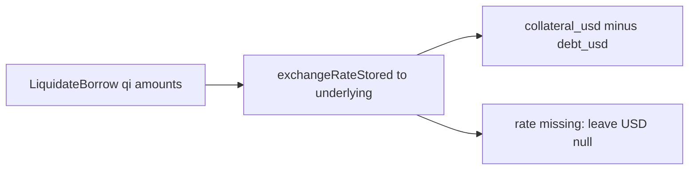

# سود لیکوییدیشن Benqi روی underlying

الان [`decode/liquidation.rs`](core/src/explorer/decode/liquidation.rs) برای `LiquidateBorrow` بازار بدهی را خودِ qiToken (emitter) و وثیقه را `cTokenCollateral` می‌گذارد. مقدارها `repayAmount` / `seizeTokens` هستند، نه underlying. [`store/pnl.rs`](core/src/explorer/store/pnl.rs) همان آدرس‌ها را قیمت می‌زند:

- `0x2101e976…`: وثیقه `qiAVAX`، بدهی `qiBTC.b`، هیچ‌کدام قیمت ندارند، `profit_usd = NULL` (سایت $645.86)
- `0x4e2fce2b…`: `qisAVAX` قیمت خورده، $491.16 به‌جای $29.70

## تغییر

- در [`core/data/chains.toml`](core/data/chains.toml) کنار aliasهای فعلی یک مپ `qiToken → underlying` برای بازارهای core بنویسیم. `qiAVAX` به WAVAX. بقیه: `qiBTC.b→BTC.b`، `qisAVAX→sAVAX`، `qiUSDCn→USDC`، `qiUSDTn→USDT`، `qiUSDC→USDC.e`، و بقیهٔ بازارهای core که underlyingشان معلوم است. بازار isolated بدون underlying در مپ نمی‌آید.
- فیلد را مثل `chainlink_feeds` از [`ChainConfig`](core/src/config/defaults.rs) به [`IngestConfig`](core/src/explorer/ingest.rs) برسانیم.
- قبل از `warm_prices_for_tokens`، برای لیکوییدیشنی که وثیقه یا بدهی‌اش در این مپ است `exchangeRateStored()` را روی همان بلاک بزنیم. تبدیل: `underlying = amount * rate / 1e18`. نرخ را ساعتی کش کنیم، miss را هم کش کنیم تا نود pruned هر بلاک را بلوکه نکند.
- در `details` آدرس و مقدار qi را نگه داریم (`qi_collateral_asset` / `qi_debt_asset` و amountهای خام). `collateral_asset`، `debt_asset`، `profit_token` و `profit_amount` را با underlying عوض کنیم تا [`liquidation_pnl`](core/src/explorer/store/pnl.rs) و `event_tokens` روی WAVAX / BTC.b / USDC قیمت بزنند.
- اگر نرخ نیامد، qiToken را قیمت نزنیم. `profit_usd` خالی بماند با دلیل `QI_EXCHANGE_RATE_MISSING`. این همان مسیر $491 است و نباید تکرار شود.

`profit_token` می‌شود underlying وثیقه (برای اولی WAVAX، نه BTC.b که سایت نشان می‌دهد). هدف دلار است: `usd(underlying seized) − usd(underlying repaid)`. توکن نمایشی سایت اگر بعد از سواپ باشد جداست.

## تست

- واحد: نرخ ساختگی، `seizeTokens` → مقدار underlying.
- PnL: بعد از تبدیل، قیمت underlyingها `c - d` بدهد؛ بدون نرخ، `profit_usd` خالی بماند و qiToken قیمت نخورد.
- تست کانفیگ: مپ آوالانچ از toml لود شود.

ردیف‌های فعلی sqlite تا reindex همان پنجره عوض نمی‌شوند. بعد از merge، `blocks_classified` همان بازه پاک و `explorer index` دوباره زده شود.