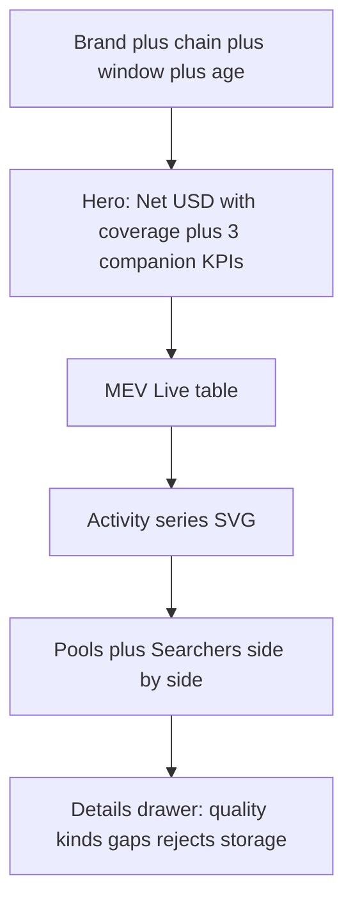

# Dashboard UI Redesign (minimal / clear)

## Diagnosis

Current [`core/data/dashboard_template.html`](core/data/dashboard_template.html) is a **15-panel lab notebook** (P0–P15 + left rail of codes). That matches forensic completeness, not insight. First viewport screams schema/caps instead of “what money moved.”

[explorer.mev.zone](https://explorer.mev.zone/) works because the story is linear:

1. Overview KPIs (ops / profit / avg)
2. Live feed table (time · route · profit · searcher)
3. Activity chart
4. Top pools / DEXes
5. Leaderboard / senders

**We keep our honesty edge** (≈ USD, coverage fractions, null ≠ 0, schema banners) but adopt their information hierarchy.

## Scope (concrete)

**Only rewrite** [`core/data/dashboard_template.html`](core/data/dashboard_template.html) (CSS + JS render). No Rust snapshot / CLI / panel data changes. JSON/`--format csv` stay as-is for forensics.

## Target layout (one page, no left P0–P15 rail)

### First viewport (one composition)
- Brand: `mev-scout` (large), chain subtitle (`avalanche · C-Chain`)
- One headline number: **Net ≈$X** with coverage chip (`priced n/N`)
- Three quiet companions: ops · gross · gas (not a KPI card farm)
- One-line honesty: window span + schema status only if not `at_head`
- Soft filters: kind / confidence / search (hash-persisted, keep existing behavior)

### Sections (human names, not P-codes)
| Section | Source | Role |
|---------|--------|------|
| MEV Live | `panels.events` | Primary table: time, kind, short hash→drill, net, searcher |
| Activity | `panels.series` | Dual-line ops + net (existing SVG helpers, restyled) |
| Top pools | `panels.pools` | Rank by net |
| Searchers | `panels.actors` | Rank by net |
| Details (collapsed) | quality, kind_matrix, gaps, rejects, oracles, storage, P0 meta | Power-user; closed by default |

Drill-down (`#/op/<tx_hash>`) stays: slide-over or inline expand under Live row—not a separate nav destination.

## Visual direction (avoid AI purple/cream defaults)
- Light forensic surface: warm off-white paper `#F7F4EF`, ink `#1A1A1A`, single accent **Avalanche red** `#E84142`
- Display: `"Fraunces"` (Google Fonts link OK for local viewing; fallback Georgia)
- Body/UI: `"IBM Plex Sans"`; tables `"IBM Plex Mono"` tabular
- No left sidebar; max-width ~1100px centered; hairline rules; almost no cards
- Motion: fade-in sections; row highlight on hover; Details open height transition

## Implementation steps
1. Replace template shell: drop `#nav` P-list; new header + section IDs (`#live`, `#activity`, `#pools`, `#searchers`, `#details`).
2. Rewrite `renderAll()` to hero → live → activity → boards → details; map existing snapshot fields (no backend change).
3. Restyle tables/SVG to match the light palette; keep `≈` / `—` / coverage chips.
4. Smoke: regenerate `results/dash.html` from seeded DB; open `file://`; confirm no console errors and first viewport reads as one composition.

## Acceptance
- First screen answers “how much net, how trustworthy, what’s hot” without scrolling past schema soup
- Live table is the visual anchor (like MEV.ZONE)
- Details still expose full forensic depth when opened
- Offline `file://` still works (fonts fail-soft to system if CDN blocked)
