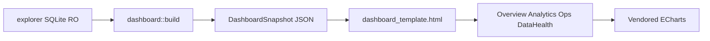

# MEV Scout Dashboard Visual Redesign

## Goal

Replace the single-scroll cream “forensic essay” UI in [`core/data/dashboard_template.html`](core/data/dashboard_template.html) with a multi-view analytics shell that matches the **data-driven** vibe concepts under [`vibe_images/`](vibe_images/) (dark night-ops + real sample magnitudes), while keeping the existing Rust pipeline:

`explorer dashboard` CLI → [`build()`](core/src/explorer/dashboard/mod.rs) → `DashboardSnapshot` → [`render::to_html`](core/src/explorer/dashboard/render.rs) → self-contained HTML.

[`cli/src/commands/explorer/dashboard.rs`](cli/src/commands/explorer/dashboard.rs) stays an emit/write command. Visual work lives in the template + small read-model additions in [`reduce.rs`](core/src/explorer/dashboard/reduce.rs) / [`evidence.rs`](core/src/explorer/dashboard/evidence.rs).

## Vibe images = visual acceptance target

Yes: after the phases land, the shipped HTML should **feel and read like** [`vibe_images/`](vibe_images/), not like the current cream single-scroll template. That is the definition of done for UI look/IA.

**Primary targets (data-driven concepts — match layout + widgets):**

| Image | Ships in | Must match |
|-------|----------|------------|
| `mev-scout-overview-data-concept_*.png` | Phase 1 | Sidebar, 6 KPIs (no headline volume), profit+activity, subkind donut, priced gauge, top searchers, live ops + unpriced badge |
| `mev-scout-analytics-data-concept_*.png` | Phase 2 | Heatmap by subkind×time, mix + exact/inferred, net-by-strategy, AMM treemap, log profit-vs-volume scatter + `VOLUME_PARTIAL` tooltip + unpriced caption |
| `mev-scout-operation-data-concept_*.png` | Phase 3 | Op header badges, 4 metrics, profit waterfall, facts, 2-hop AMM route (observed labels), evidence tags, collapsed raw JSON |

**Secondary references (steal widgets / density, not pixel skin):**

- `mev-scout-overview-concept_*` / `mev-scout-analytics-concept_*` / forensic / night-ops assets under chat `assets/` or older vibe files → indexing health gauge ideas, waterfall/route/confidence checklist cues, pulse chart density.

**What “reaching vibe_images” does *not* mean:**

- Pixel-perfect Figma clone or identical axis tick labels from AI mockups
- Hardcoded mock KPIs ($0.93 / 90 ops / 6 JIT) when the open DB differs — numbers always come from `DashboardSnapshot`
- Inventing branded DEX icons (Trader Joe / Pangolin) when the DB only has `amm: "v3"` + pool addresses
- Light cream Fraunces “observatory” skin as the final theme — dark data-concept is the locked skin

**Acceptance check:** open regenerated HTML next to the three `*-data-concept` PNGs; a reviewer should recognize the same views/widgets without needing the old Details drawer essay.

## Non-negotiable data rules (implementer checklist)

Copy these into code comments near the USD formatters / chart builders. Fail review if any are violated.

1. **Null USD ≠ zero.** `usd(null)` renders an em-dash / “unpriced”, never `$0`. Do not `|| 0` on profit/net/gas/volume for display axes.
2. **Unpriced ops stay countable.** Include them in op counts, strategy mix, heatmaps, searcher op counts. Exclude them from **USD axes** (profit line, net bars, scatter USD coords) and show an explicit caption (e.g. “N JIT unpriced — in counts, not USD axes”). Current sample DB: 12/12 JIT unpriced; vibe mock showed 6 — **always bind to `kpi.quality.ops_unpriced` / filtered events**, never hardcode.
3. **No headline aggregate volume.** Overview KPIs = Net, Gross, Ops, Searchers, Gas, Pricing coverage (as in `mev-scout-overview-data-concept`). Volume only in Analytics as **log-scaled** scatter/chart with outlier tooltips (`VOLUME_PARTIAL`, raw `volume_usd`). Live DB max volume ≈ `$1.2e11` with tiny net — that is the motivating case.
4. **Show subkinds.** Never roll `utility` into one bucket. Donuts/heatmaps/filters must split `utility/bundler` vs `utility/claim_and_sell` (and any other `kind/subkind`). Display label helper: `kind === "utility" && subkind ? subkind : kind` with stable colors per slice key `kind + "/" + (subkind||"")`.
5. **Confidence is exact|inferred**, not a fake %. Use badges + evidence checklist; do not invent “98%”.
6. **AMM labels = observed `route[].amm`** (`v2`/`v3`/`v4`/`lb`/aggregator-style strings from DB). Branded DEX names / token icons only when a **reliable** mapping exists (labels table or known registry + `token_source === "registry"`). Otherwise truncate pool address + AMM family.
7. **Semantics footer everywhere:** reuse `snapshot.semantics` (`null_usd_means`, `usd_columns_are`, …). Prefix priced USD with ≈.

## What already exists (reuse, don’t recompute blindly)

| Need | Source |
|------|--------|
| KPIs + priced/unpriced/exact/inferred | `panels.kpi`, `panels.kpi.quality` |
| Time series ops + net + blocks | `panels.series`, `panels.bucket_secs` |
| Kind × subkind × confidence | `panels.kind_matrix` |
| Searchers / pools / tokens | `panels.actors`, `pools`, `tokens` |
| Event table rows | `panels.events` (may be truncated) |
| Drill evidence (route, tags, reasons, details) | `panels.evidence` → `OpEvidence` |
| Coverage / gaps / rejects / caps / storage | `coverage`, `gaps`, `rejects`, `caps`, `storage` |
| Route legs | `evidence::RouteLeg` (`pool`, `amm`, `token_*`, amounts) |

**Do not** derive strategy×time or actor×time charts from truncated `events` for “complete” Analytics. When Analytics needs those, **add aggregates in `reduce.rs` first** (see Phase 2).

## Design decisions locked for handoff

- **Theme:** Dark night-ops / data-concept (deep navy/charcoal, mint/teal gain, coral loss, purple secondary). Avalanche red only as sparse brand accent, not purple-on-white or cream Fraunces paper.
- **IA:** Left sidebar + main stage. Views: **Overview**, **Analytics**, **Operations**, **Data Health**. Operation drill-down is a full panel/route under Operations (not only a thin aside), inspired by `mev-scout-operation-data-concept`.
- **Charts:** Vendored **Apache ECharts** (minify into repo, e.g. `core/data/echarts.min.js`, inlined or `` via `escape_json_for_script`.

## File touch map

| File | Change |
|------|--------|
| [`core/data/dashboard_template.html`](core/data/dashboard_template.html) | Full UI rewrite (phased) |
| `core/data/echarts.min.js` | New vendored asset |
| [`core/src/explorer/dashboard/render.rs`](core/src/explorer/dashboard/render.rs) | Embed echarts; fix tests |
| [`core/src/explorer/dashboard/reduce.rs`](core/src/explorer/dashboard/reduce.rs) | Phase 2: `strategy_series` (+ optional scatter extract) |
| [`core/src/explorer/dashboard/evidence.rs`](core/src/explorer/dashboard/evidence.rs) | Only if drill needs extra typed fields from details |
| [`core/src/explorer/dashboard/mod.rs`](core/src/explorer/dashboard/mod.rs) | Usually untouched; keep semantics |
| [`cli/.../dashboard.rs`](cli/src/commands/explorer/dashboard.rs) | Untouched unless documenting flags |