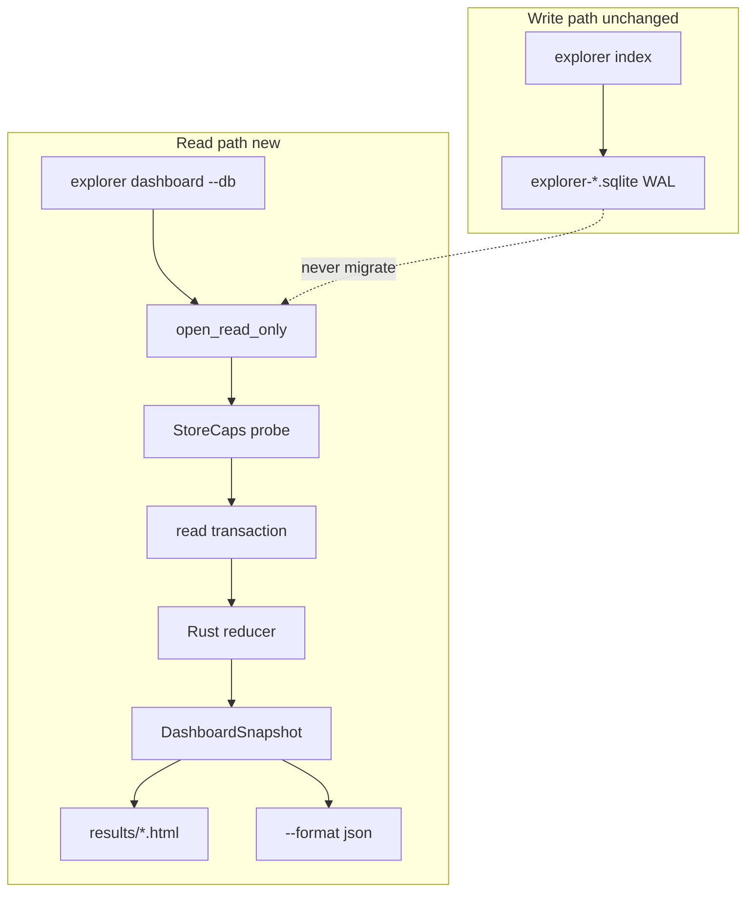

# Explorer MEV Analytical Dashboard

## Verdict

Build a **CLI-emitted, self-contained HTML snapshot** (plus `--format json`) inside the existing Rust workspace. Do **not** introduce Metabase, Rill Data, Datasette, or a Node/SPA stack for v1.

Primary target DB: `cache/explorer-avalanche.sqlite` (Avalanche C-Chain `43114`). Architecture stays chain-agnostic via **one SQLite file per chain** ([`schema.rs`](core/src/explorer/store/schema.rs) facts are not chain-keyed; config already refuses a shared `explorer.db_path`).

This supersedes “There is no web UI” in [`docs/LOCAL_AVALANCHE.md`](docs/LOCAL_AVALANCHE.md) with: *no served UI; `explorer dashboard` emits a static file*.

A prior measured design lives in [`.qoder/specs/...explorer-avalanche.sqlite.md`](.qoder/specs/طرح%20جامع%20داشبرد%20کاوشگر%20MEV%20(Avalanche)%20روی%20`explorer-avalanche.sqlite`.md). Update assumptions: **schema head is now 11** (`MIGRATIONS` through `migrate_v11_paper_fill_verification`); no explorer DB is present in this checkout (gitignored).

---

## Why not Metabase / Rill / similar (SQLite tradeoffs)

| Tool | Fit | Deal-breaker here |
|------|-----|-------------------|
| **Metabase** | Fast charts on SQL | Wants a server + JVM; poor honesty around `NULL ≠ 0` USD; will happily open RW; no understanding of `route_json` / `excluded_from_net` asymmetry; overkill for laptop+SSH forensic workflow |
| **Rill Data** (“Raildata”) | Great metric models / duckdb OLAP | Extra runtime + model YAML; SQLite is secondary; still a served app; weak for deep-link op evidence / capability banners on schema v0 vs v11 |
| **Datasette / Evidence** | Nice static-ish SQLite UIs | Still a Python/Node toolchain the repo deliberately dropped; cannot encode MEV semantics (net-gating, pricing flags) without duplicating Rust |
| **Custom axum + SPA** | Rich UX | ~100 crates, ports on boxes whose RPC is `127.0.0.1`, migrate-on-open risk unless carefully isolated |
| **Rust → static HTML** (chosen) | Offline `file://`, zero migrate, zero secrets, same semantics as CLI report | Manual SVG; refresh = regenerate (`--repeat`) |

**Constraint that decides it:** today’s [`ExplorerStore::open`](core/src/explorer/store/schema.rs) **always migrates**. A dashboard that uses `open()` silently upgrades stale DBs (V8 table rebuilds, etc.). Structural fix = `open_read_only` that never runs migrate and never sets `journal_mode=WAL`.

---

## Prioritized metrics (actionable)

Always show **coverage fraction** next to any USD sum (`priced/N`). Prefix USD with `≈`. `NULL` → `—`, never coerced to 0.

1. **Net USD (loss-gated)** — `SUM(net_profit_usd) WHERE excluded_from_net = 0` ([`NET_USD_AGG`](core/src/explorer/store/query.rs)); unavailable on pre-V4 → banner, not fake net
2. **Gross / gas / flash-fee / volume USD** — inclusive counts; volume is often sparse → never headline without coverage
3. **Pricing quality** — priced/unpriced, exact/inferred, `usd_approximate`, `native_unpriced`, `multi_asset_pricing`, `pricing_clamped`, `flash_fee_unpriced`, `excluded_from_net` (V10 columns in [`report_window_overview`](core/src/explorer/store/query.rs))
4. **Ops density** — ops per indexed block; window wall-clock vs indexed span (avoid reading 24m as 30d)
5. **Kind × confidence matrix** — all [`MevKind::ALL`](core/src/explorer/types.rs) with explicit zeros; normalize legacy `unknown` → `utility` with a counted rewrite
6. **Competitor / pool leaderboards** — see ranking below
7. **Index health** — `sync_state.head` / `indexed_to` / lag; optional gaps behind `--with-gaps`

---

## Chain focus

- **v1 ship target:** Avalanche C-Chain only in docs, demos, and acceptance (`chain_id` from `sync_state`, label from filename stem `explorer-{chain}`).
- **Code:** accept `--db <path>` for any per-chain explorer file (Polygon/BSC later without schema change).
- **Out of scope:** multi-DB compare / cross-chain join (facts lack `chain` column).

---

## Ranking profitable pools & tokens

Reuse report semantics, but compute pool rank in the **Rust reducer** (parse `route_json` once) instead of hot-path `json_each` ([`top_pools_filtered`](core/src/explorer/store/query.rs)).

**Pool score (default sort):**

```
rank_key = net_usd_gated DESC, then gross_usd DESC, then ops DESC, then pool ASC
```

Per pool row show: `ops`, `gross_usd`, `net_usd`, `gas_usd`, `priced_ops/ops`, `amm_mix` (from swap legs / `route_json.amm`), `unique_competitors`, `top_kind`.

**Filters that change the leaderboard:** window, kind, confidence, `priced_only`, `min_net_usd`, tag/reason facets.

**Token ranking (extra vs CLI today):** aggregate `profit_token` (and route `token_in`/`token_out` for flow) with the same coverage rules; humanize amounts only when decimals exist in `core/data/known_tokens.json`.

**Honesty rule from pricing:** only `registry`/`transfer` token sources produce USD; `proximity` never does — surface `token_source` coloring on route legs.

---

## Concrete UI layout (single page)

Sticky top: file, chain, `user_version` vs `SCHEMA_HEAD` (= `MIGRATIONS.len()` = **11**), window, `generated_at`, coverage banner.

Left rail jumps to panels:



| Panel | Purpose |
|-------|---------|
| P0 Data reality | Path, schema caps, window length |
| P1 Coverage / sync | head, indexed_to, density, ts lag |
| P2 Gaps | opt-in unclassified blocks |
| P3 KPI grid | ops, volume, gross, gas, fee, net, peak, searchers |
| P4 Pricing quality | never collapsible |
| P5 Time series | auto bucket; ops + net; block-coverage band |
| P6 Kind matrix | zeros kept |
| P7 Actors | competitor = `COALESCE(contract,eoa)` + labels |
| P8 Pools / routes | leaderboard + per-pool op list |
| P9 Events table | stable sort `block, tx_index, id` |
| P10 Op drill-down | `#/op/<tx_hash>`; details_json sections |
| P11 Tag/reason facets | built from data (incl. out-of-catalogue tags) |
| P12 Reject funnel | empty = recording off, not “no rejects” |
| P13 JIT lifecycle | realized ops vs `jit_open_positions` detector state |
| P14 Oracles / rates | feeds + hour-bucket `prices` caveat |
| P15 Storage health | table counts; dead columns; retention debt |

Filters persist in **hash fragment** (works under `file://`).

---

## Extra features that meaningfully help

- **Capability banners** for missing columns (v0 vs v11) instead of SQL errors
- **`--repeat Ns`** atomic rewrite for near-live refresh without a server
- **Byte budget** (`--max-ops`, `--evidence`, `--budget-mb`) + red truncation bar
- **CSV export** aligned with existing report CSV columns for reconcile
- **Reconciliation test** vs `report_window_overview` / `report_by_kind` on a v11 fixture (skip if absent)
- **Semantics envelope** in JSON (`null_usd_means`, `net_excludes`, …) so non-HTML consumers stay honest

---

## Tech stack & build strategy

**Stack:** `rusqlite` (existing, bundled) + new `core/src/explorer/dashboard/*` + `include_str!` HTML template + hand-rolled SVG helpers + clap subcommand. No npm, no CDN, no axum.

**Architecture decision:** adaptive projection + **single Rust reducer** for KPIs/series/matrices/leaderboards. Do not bind panels to today’s `MEV_OP_COLUMNS` / `report_window_overview` alone — those assume ≥V8/V10 and break on stale files. Keep `query.rs` report path lockstep; add dashboard-specific reads + reconcile tests.

**CLI:**

```text
mev-scout explorer dashboard --db cache/explorer-avalanche.sqlite \
  --window 24h --out results/dash.html
# offline: no validate_live, no mev-scout.toml required when --db set
```

---

## Implementation map

**New**

- [`core/src/explorer/dashboard/mod.rs`](core/src/explorer/dashboard/mod.rs) — `DashboardSnapshot`, `build()`
- `caps.rs`, `reduce.rs`, `evidence.rs`, `render.rs`
- [`core/data/dashboard_template.html`](core/data/dashboard_template.html)
- [`cli/src/commands/explorer/dashboard.rs`](cli/src/commands/explorer/dashboard.rs)
- Tests: `core/tests/explorer_dashboard_readonly.rs`, `cli/tests/cli_dashboard.rs`

**Touch (append-only)**

- [`core/src/explorer/store/schema.rs`](core/src/explorer/store/schema.rs) — `SCHEMA_HEAD`, `open_read_only`, `user_version()`
- [`core/src/explorer/mod.rs`](core/src/explorer/mod.rs), store re-exports
- [`cli/src/cli.rs`](cli/src/cli.rs) + explorer command arm
- Docs: `CLI.md`, `ARCHITECTURE.md`, fix `LOCAL_AVALANCHE.md`

**Milestones:** M0 read-only+sha256 guard → M1 JSON envelope → M2 reducer → M3 static HTML/SVG → M4 events+drill-down → M5 pools/JIT/feeds/storage → M6 window/gaps/repeat/docs.

**Acceptance:** sha256 of DB unchanged after dashboard; Avalanche (or fixture) HTML opens via `file://` with no network; P0 states schema version; KPI JSON reconciles with bare `explorer` report on overlapping windows for v11 DBs.
