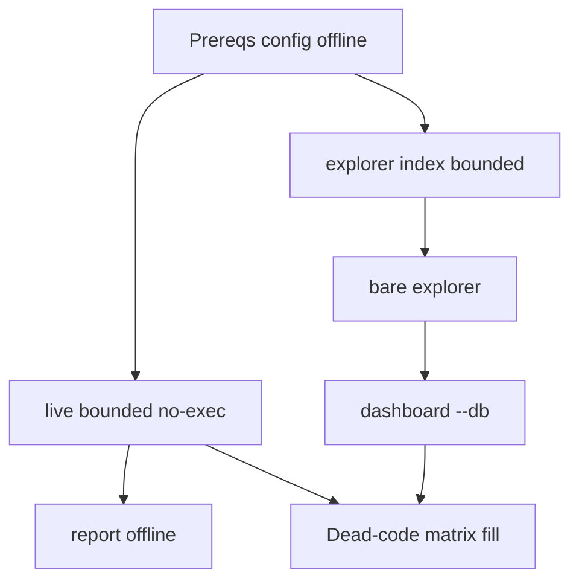

# Live + Explorer Operational Checklist Guide

## Deliverable

یک فایل جدید مثل [`docs/live_explorer_ops_checklist.md`](docs/live_explorer_ops_checklist.md) (یا به‌روزرسانی [`docs/CLI.md`](docs/CLI.md) فقط اگر ترجیح بدهی؛ پیش‌فرض: فایل جدا تا CLI.md حجیم نشود) که راهنمای عملیاتی + چک‌لیست شناسایی dead code / ساده‌سازی minimalist باشد.

**این مرحله فقط نوشتن راهنماست.** اجرا و پیشنهاد cleanup در نوبت بعد (طبق درخواست خودت).

منبع حقیقت کد (نه حدس):

- CLI: [`cli/src/cli.rs`](cli/src/cli.rs), [`cli/src/commands/live.rs`](cli/src/commands/live.rs), [`cli/src/commands/mod.rs`](cli/src/commands/mod.rs), [`cli/src/commands/explorer/*`](cli/src/commands/explorer.rs)
- Jobs: [`core/src/jobs/live.rs`](core/src/jobs/live.rs), [`core/src/jobs/index.rs`](core/src/jobs/index.rs)
- Config: [`core/src/config/settings.rs`](core/src/config/settings.rs), [`mev-scout.example.toml`](mev-scout.example.toml)
- Docs موجود: [`docs/CLI.md`](docs/CLI.md), [`docs/ARCHITECTURE.md`](docs/ARCHITECTURE.md)

---

## Document structure (what will be written)

### 0. Safety rails (اول صفحه)

- هیچ `--exec testnet` بدون تایید صریح؛ پیش‌فرض `none`.
- `--exec anvil` فقط به fork محلی می‌نویسد؛ mainnet broadcast ندارد.
- برای audit از **کپی جدا** DB استفاده کن یا مسیرهای scratch:
  - scanner: `./cache/{chain}-mev-scout.sqlite`
  - explorer: `./cache/explorer-{chain}.sqlite`
  - dashboard: `results/*` (gitignored)
- `explorer.db_path` مشترک با چند `[chains.*]` ممنوع (`validate_explorer_db_isolation`).
- اول‌بار `live` ممکن است hybrid discover + aggregator HTTP بزند؛ برای بدون side-effect شبکه‌ایِ اضافه: `[discover].source = "onchain"` یا cache از قبل warm.
- `--quiet` فقط tracing را می‌خواباند؛ جداول stdout می‌مانند.

### 1. Product split (یک جمله)

| Module | سؤال | Write |
|---|---|---|
| `live` | چه چیزی *می‌توانست* گرفته شود + ledger مجازی | cache + explorer opps/paper |
| `explorer` | چه چیزی *واقعاً* استخراج شد | forensic tables؛ dashboard فقط read |

### 2. `live` — کامل

**Globals:** `-f/--config`, `-v/--verbose`, `--quiet`

**Flags (clap):**

| Flag                    | Default                           | Notes                               |
| ----------------------- | --------------------------------- | ----------------------------------- |
| *(bare `mev-scout`)*    | ≡ `live` با `LiveArgs::default()` |                                     |
| `--blocks N`            | `64`                              | فقط one-shot؛ range `tip-N+1..=tip` |
| `--loop`                | false                             |                                     |
| `--duration`            | none                              | **requires `--loop`**               |
| `--max-blocks`          | none                              | **requires `--loop`**               |
| `--initial-balance WEI` | none → `[paper].starting_gas_wei` | default `10e18`                     |
| `--reserve WEI`         | none → `[paper].reserve_wei`      | default `0`                         |
| `--sim assumed          | state`                            | none → `[paper].sim` = `assumed`    |
| `--exec none            | revm                              | anvil                               |

**TOML که live واقعاً می‌خواند:** `[live].poll_interval_ms=2000`, کل `[paper].`*, `chain`, `strategies` (فقط emptiness برای `init_pools`؛ membership detectors را gate نمی‌کند), gas keys, `record_rejections`, `capture_pending`, `min_profit_wei`, `max_candidates_per_tx`, `max_pairs_per_token`, RPC, `[discover].`* فقط وقتی pool cache خالی است، `explorer.db_path` برای persist.

**TOML بی‌اثر روی live (کاندید dead/simplify):** `output`, `batch_rpc`, `block_concurrency`, `rpc_batch_blocks`, `gas_limits`, `[explorer]` classification knobs / `mev_tolerance_`*, membership داخل `strategies`.

**Dead-code probes از قبل شناخته‌شده (برای چک در اجرا):** `LiveOpts.initial_balance_usd`/`native_usd` بدون clap؛ `StdoutJsonProgress` بدون constructor؛ `sigs`/`with_sig_resolver` بی‌caller از jobs؛ `jobs::run`/`tokens` library-only؛ `JobProgress::cancelled` همیشه false در binary.

**Runnable checklist steps (PowerShell, CWD=repo root):**

1. پیش‌نیاز: `copy mev-scout.example.toml mev-scout.toml` (یا `-f`); `mev-scout config` → offline dump.
2. Fail-fast (بدون RPC موفق لازم): `live --duration 15m` باید خطا بدهد؛ `live --loop --duration notatime` باید fail کند.
3. Minimal scan (writes cache+explorer): `cargo run -p mev-scout-cli -- -f mev-scout.toml --quiet live --blocks 8`
4. Report offline: `mev-scout report` → همان `run_id` / ledger.
5. Optional deeper (بدون broadcast): `--sim state --blocks 8`؛ `--exec revm --blocks 8`.
6. Loop smoke: `live --loop --duration 30s` با `[live] poll_interval_ms` کوتاه.
7. معیارها: exit 0؛ خطوط `Run ID:`, `ledger:`/`wallet:`؛ فایل‌های sqlite رشد؛ بدون `eth_sendRawTransaction` مگر `--exec testnet`.

### 3. `explorer` — کامل

**Subcommands:** bare report | `index` | `dashboard`. حذف‌شده‌ها (نباید در clap باشند): `stats`, `report`, `backfill` به‌عنوان subcommand — منطق backfill هنوز `cmd_backfill` از `index` بدون `--loop`.

**Bare flags:** `--windows` default `1d,7d,30d`; `--kind`; `--top` default `10`; `--confidence exact|inferred|all`.

`**index` flags:** `--loop`, `--duration` (requires loop), `--days 1..=365` (default 7 اگر range ندهی), `--from-block`+`--to-block`. ناسازگار با `--loop`.

`**dashboard` flags:** `--db`, `--window`=`24h`, `--out`=`results/dash.html`, `--format html|json|csv`, `--max-ops`=`2000`, `--evidence`=`500`, `--budget-mb`=`8`, `--with-gaps`, `--repeat`.

`**[explorer]` defaults:** `confirmations=6`, `poll_interval_ms=2000`, `mev_tolerance_pct=20`, `mev_error_usd_tol=0.50`, `causal_window_txs=8`, `causal_price_min_pct=0.5`, `jit_window_blocks=1000`, `interest_lookback_blocks=300`, `jit_pool_fee_bps=30`. Index این‌ها را به `IngestConfig` می‌فرستد؛ bare/dashboard عمدتاً SQL/read.

**Runnable checklist:**

1. Bounded index (RPC+writes forensic): `explorer index --from-block TIP-N --to-block TIP` با N کوچک (مثلاً 50–200) یا `--days 1`.
2. Offline report: `explorer --windows 1d,7d --top 5`.
3. Dashboard بدون migrate: `explorer dashboard --db cache/explorer-<chain>.sqlite --format json --out results/dash.json`.
4. Loop کوتاه: `explorer index --loop --duration 2m` (فقط tip-follow؛ historical catch-up ندارد).
5. معیارها: `mev_ops`/`blocks_classified` رشد؛ dashboard با `--db` بدون نیاز به RPC؛ report flags روی `index`/`dashboard` باید bail کنند.

### 4. Cross-module dead-code / minimalist audit matrix

جدول چک‌لیست برای هر کاندید: *observed in run?* | *optional path?* | *safe to remove?* | *depends on tests?*

شامل حداقل این ردیف‌ها:

- config keys parsed-but-unused on path
- clap flags vs `LiveOpts` fields بدون UI
- removed CLI commands still as library (`job_run`, `job_tokens`)
- progress cancel / StdoutJsonProgress
- strategies membership inert
- duplicate validate/duration parse in CLI+job
- explorer modules never reached from live (classify/decode/dashboard)
- live modules never reached from explorer index (detectors/paper exec)

### 5. Expected evidence pack (خروجی که بعداً برای cleanup می‌آوری)

- stdout snippets از هر step
- `sqlite3 … ".tables"` / `SELECT COUNT(*)` روی opportunities / mev_ops / paper_sessions
- لیست کلیدهای TOML که در run واقعاً اثر داشتند vs نداشتند
- لیست فایل‌های `core/src` و `cli/src` که در call graph آن run لمس نشدند (از tracing `--verbose` یا grep call sites)

---

## Implementation notes (وقتی تأیید شد)

- فقط markdown راهنما؛ بدون تغییر رفتار runtime.
- لینک متقابل کوتاه از [`docs/CLI.md`](docs/CLI.md) §live/§explorer به این چک‌لیست (۱–۲ خط).
- دستورات PowerShell؛ `cargo run -p mev-scout-cli -- …` به‌عنوان شکل کامل.
- فارسی یا انگلیسی؟ پیش‌فرض: بدنه چک‌لیست **انگلیسی فنی** (مثل docs فعلی) + عنوان/مقدمه کوتاه فارسی اگر بخواهی؛ ترجیح docs فعلی انگلیسی است مگر خلافش را بگویی.

