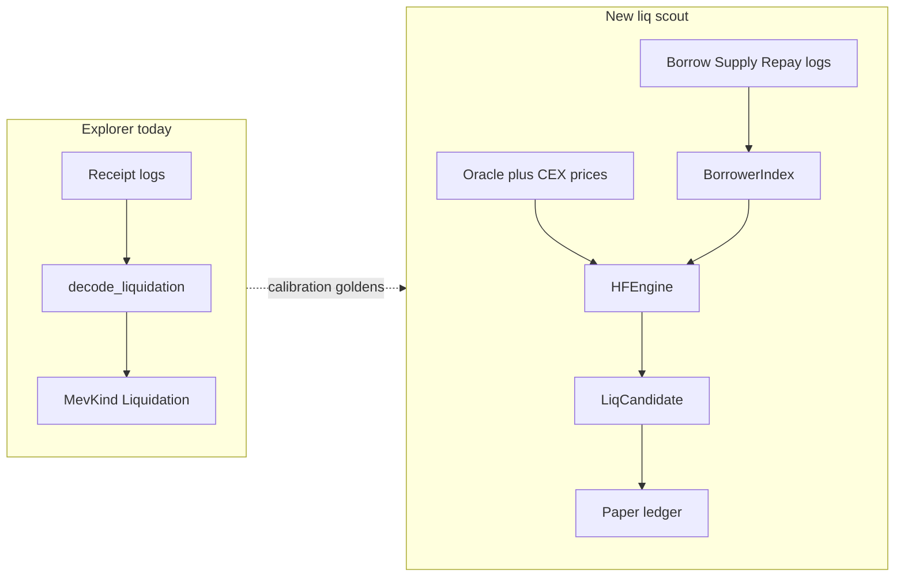

# Proactive Liquidation Searcher

## توصیه: الان به `live` اضافه نکن

**نه.** `live` امروز یک loop بلاک‌محور DEX است (`PoolManager` + `BacktestRunner` + arb/JIT/backrun) و fillها paper هستند؛ `Strategy::Liquidation` عمداً retired شده ([`core/src/types/strategy.rs`](core/src/types/strategy.rs)).

دلایل:
- مدل تریگر متفاوت: HF / oracle / interest، نه «sync pools → scan swaps»
- شکل فرصت متفاوت: borrower+debt+collateral، نه `pool_a/pool_b/path`
- hybrid/mempool pathهای live اصلاً lending را نمی‌بینند
- explorer فقط **پس از واقعه** decode می‌کند؛ هیچ borrower index / HF ندارد

**Locked delivery:** job/module جدا + paper ledger (مثل live). بدون builder/submit در این پلن. Submission لایهٔ بعدی است.

اجرای موازی با `live --loop` به‌صورت process جدا OK است؛ event loop را merge نکن.



---

## پروتکل‌های هدف (همان labels اکسپلورر)

از [`core/src/explorer/decode/liquidation.rs`](core/src/explorer/decode/liquidation.rs) + remap در ingest:

| Family | Labels | Config امروز |
|--------|--------|--------------|
| Aave-family | `aave_v3`, `aave_v2`, `spark` | pools در [`core/data/chains.toml`](core/data/chains.toml) |
| CToken forks | `compound_v2`, `benqi`, `venus` | aliases + `c_token_underlyings` |
| Comet | `compound_v3` | topic-only؛ Comet addresses باید اضافه شوند |
| Morpho | `morpho_blue` | address pinned؛ market params لازم |
| Silo | `silo_v2` | config schema خالی |
| Euler | `euler_v2` | factory schema خالی |

معماری از روز اول همه را با trait پوشش می‌دهد؛ پیاده‌سازی HF به‌ترتیب اولویت corpus/config قفل می‌شود (پایین).

---

## Shape پیشنهادی

| قطعه | محل |
|------|-----|
| CLI | `cli/src/commands/liq.rs` — `mev-scout liq` (mirror الگوی [`cli/src/commands/live.rs`](cli/src/commands/live.rs)) |
| Job | [`core/src/jobs/`](core/src/jobs/) → `liquidate.rs` |
| Core | `core/src/liquidation/` — index, oracle, engines, profit, paper bridge |
| Config | بخش جدید `[liquidation]` + reuse فیلدهای lending در `ChainConfig` |
| Paper | استخراج helper مشترک از `LiveContext` برای `LedgerPolicy` / `insert_paper_session`؛ `Strategy::Liquidation` را **فقط برای paper eligibility** برگردان، نه داخل `BlockDetectors` |
| Calibration | corpusهای [`docs/explorer_strategy_checklist.md`](docs/explorer_strategy_checklist.md) به‌عنوان truth پس از واقعه |

`BacktestRunner` / `mev/detectors/*` را لمس نکن مگر برای shared RPC utils.

---

## هستهٔ runtime

```text
bootstrap borrowers (event backfill)
  → BorrowerStore (in-memory + optional SQLite)
  → on new block / oracle tick:
       recompute HF for hot-set (exposed to moved feeds)
       emit LiqCandidate when HF < 1 (or near-threshold watch)
       estimate bonus − flash fee − swap cost − gas
       paper fill if net > 0
```

### `LiqCandidate` (جایگزین `MevOpportunity` برای این مسیر)

حداقل فیلدها: `protocol`, `chain`, `user`, `debt_asset`, `collateral_asset`, `debt_to_cover`, `seized_collateral`, `hf_before`, `expected_bonus_native`, `trigger` (`OracleUpdate` | `InterestAccrual` | `Rescan`), `block`.

Canonical id هم‌سبک explorer: `Liquidation|{user}|{protocol}|{debt}|{collateral}`.

### Trait واحد

```rust
trait LendingProtocol {
    fn protocol_label(&self) -> &'static str;
    fn sync_from_logs(&mut self, logs: &[Log]) -> Result<()>;
    fn recompute_hf(&self, user: Address, prices: &PriceMap) -> Result<Health>;
    fn build_liq_plan(&self, user: Address, prices: &PriceMap) -> Result<Option<LiqPlan>>;
}
```

یک آداپتر per family (نه per label): AaveFamily, CTokenFork, Comet, MorphoBlue, SiloV2, EulerV2. Remap labels (`benqi`/`venus`/`spark`) فقط metadata.

### Oracle

- on-chain: Chainlink feeds از `ChainConfig.chainlink_feeds` (همان explorer)
- speculative: اختیاری بعداً؛ P0 فقط on-chain confirmed + post-block rescan
- precompute `trigger_price` per position برای hot-set

### Profit model (paper)

Flash-loan debt → `liquidationCall`/`absorb`/… → swap collateral → repay؛ fee از `FlashLoanProvider` موجود. بدون revm path اجباری در P0: accounting arithmetic + `eth_call` static simulate برای «would succeed». State-sim pool-walk live برای liq اعمال نمی‌شود.

---

## فازبندی قفل‌شده

### P0 — اسکلت + Aave V3 (چند زنجیرهٔ pinned)

- ماژول `liquidation/`, CLI `liq`, job loop بلاک
- `BorrowerStore` از logs: Supply/Borrow/Withdraw/Repay/Liquidation روی `aave_v3_pool`
- HF از `getUserAccountData` (Multicall3) روی active set؛ بعداً local math
- Paper ledger + session در explorer DB
- Recon اختیاری: اگر همان بلاک explorer `MevKind::Liquidation` دید و ما candidate داشتیم → hit rate

### P1 — Aave-family کامل + CToken forks با config

- `aave_v2`, `spark` (همان ABI family + pool remap)
- `benqi` / `venus` / generic `compound_v2`: liquidity via `getAccountLiquidity` / exchangeRate؛ reuse `c_token_underlyings` و الگوی [`benqi_liq.rs`](core/src/explorer/benqi_liq.rs)

### P2 — Morpho Blue + Compound V3

- Morpho: market params + position from events؛ `bad_debt` awareness
- Comet: `isLiquidatable` + Absorb/BuyCollateral دو مرحله‌ای؛ **اضافه کردن Comet addresses به `chains.toml`**

### P3 — Silo V2 + Euler V2 + oracle-backrun scout

- پر کردن `silo_v2_partial_liquidation` / `euler_v2_evault_factory` در config
- pending oracle tx detection → candidates با قیمت آینده (هنوز paper bundle record، نه submit)
- near-threshold priority queue

---

## چه چیزی عمداً out of scope است

- merge به `live` / `BlockDetectors`
- Flashbots/Titan/`eth_sendRawTransaction`
- تغییر classifier اکسپلورر (فقط مصرف خروجی برای calibration)
- speculative CEX-only fire بدون on-chain confirm در P0–P1

---

## تست / پذیرش

- unit: HF fixtures per family (مقادیر ثابت)
- integration: روی بلاک‌های golden checklist (مثلاً AVAX aave_v3 / benqi، Polygon aave_v2، BSC venus) — scout باید قبل از tx لیق، همان user را در watch/liquidatable set داشته باشد اگر از N بلاک قبل bootstrap شده
- config: `liquidation` دیگر فقط retired drop نباشد؛ برای job جدید valid، برای `live` strategies همچنان reject/empty-guard حفظ شود مگر صریحاً از لیست live جدا بماند
