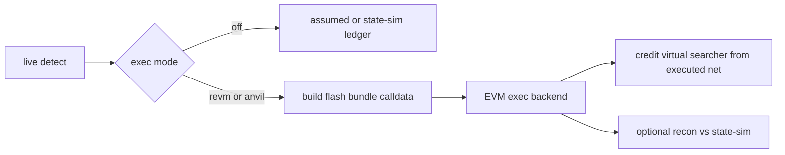

# Virtual MEV Bot Runtime (post state-sim)

## Context (done — do not rebuild)

`--sim assumed|state`، seeds، `quote_swap_post`، `apply_simulated`، و ستون‌های `paper_fills.sim_*` در درخت هستند. آن کار **تمام** است و در این پلن تکرار نمی‌شود.

شکاف واقعی نسبت به هدف تو:

- هیچ `.sol` / Foundry / Anvil نیست
- `execute_whatif` فقط در تست/corpus صدا زده می‌شود؛ bundle خودِ searcher ساخته نمی‌شود
- ولت مجازی فقط gas+P&amp;L حسابداری است، نه EOA روی زنجیرهٔ مجازی
- مسیر testnet/deploy وجود ندارد

## Goal (locked)

یک **bot مجازی state-exact روی EVM** بسازیم طوری که:

1. فرصت‌ها همان pipeline فعلی (`live`) را پیدا کنند
2. برای TwoHop / MultiHop / Backrun یک **FlashArb executor** واقعی (Solidity) مسیر را اجرا کند
3. بدون پول واقعی: روی **Anvil mainnet-fork** یا **revm in-process** (state از RPC) و بعداً **testnet** با faucet
4. P&amp;L از **نتیجهٔ اجرا** (balance delta / revert) به ledger برود، نه از claim detector
5. پیش‌فرض محصول عوض نشود: بدون flag جدید همان `assumed`؛ `--sim state` دست‌نخورده بماند

## Locked design choices

- **سطح محصول:** همان `live` با mode جدید `--exec none|revm|anvil` (default `none`). Subcommand جدا نه.
- **استراتژی‌ها:** فقط TwoHop / MultiHop / Backrun (مثل state-sim). JIT → skip صریح.
- **Flash loan اول:** Balancer Vault (`flashLoan` fee 0) — با `FlashLoanProvider::Auto/Balancer` هم‌خوان. Aave/Uniswap بعداً.
- **قرارداد:** Foundry crate جدید `contracts/`؛ artifact JSON به Rust embed/load می‌شود.
- **ولت مجازی:** یک EOA ثابتِ session (key از env/`[paper].exec_key` یا Anvil default #0) که روی fork/revm با native fund می‌شود؛ profit به همان آدرس settle می‌شود. بدون broadcast به mainnet.
- **ترتیب accept:** همان net-desc consideration + sequential commit روی backend (مثل overlay در state-sim)؛ روی Anvil واقعی tx می‌فرستیم و state زنجیره مصرف نقدینگی را نگه می‌دارد.

## Phase E0 — Foundry executor

**New:** `contracts/` (foundry.toml, `src/FlashArbExecutor.sol`, forge tests).

- `FlashArbExecutor`: `receiveFlashLoan` (Balancer) → decode leg plan → V2 `swap` / V3 `exactInputSingle` (و معادل‌های لازم برای path فعلی detectors) → repay → leftover به `profitTo`.
- ABI پایدار و versioned؛ هیچ منطق سود در Solidity فراتر از execute+repay.
- Forge tests روی Anvil fork (RPC از env) برای یک two-hop شناخته‌شده.

خروجی: bytecode + ABI قابل مصرف از Rust.

## Phase E1 — Bundle builder (Rust)

**New:** [`core/src/exec/`](core/src/exec/) (`mod.rs`, `calldata.rs`, `plan.rs`, `artifacts.rs`).

- از `MevOpportunity` → `ExecPlan { borrow_token, amount, legs[], profit_to, provider }`
- Encode calldata برای `executor.execute(...)` / Balancer flash entry
- بارگذاری artifact از `contracts/out/...` (build-time `include_bytes!` یا path config)
- Unit tests با snapshot calldata (بدون RPC)

Reuse: `input_amount` / `path` / pool kinds از [`core/src/types/opportunity.rs`](core/src/types/opportunity.rs)؛ fee/gas hints از [`FlashLoanProvider`](core/src/types/strategy.rs).

## Phase E2 — revm exec backend + live wire

**Reuse:** [`execute_whatif`](core/src/replay/whatif.rs)، [`CachedRpcDb`](core/src/replay/db.rs)، [`paper_vs_executed`](core/src/paper/recon.rs).

- Backend `ExecBackend::Revm`: در ابتدای block، bytecode executor را به آدرس deterministic deploy/inject کن؛ searcher را fund کن؛ برای هر candidate پذیرفته‌شده `TxEnv` بساز و `execute_whatif` بزن.
- `LedgerPolicy::apply_executed` (یا path موازی کنار `apply` / `apply_simulated`): fill فقط اگر `status==true` و `net_wei>0`؛ skipهای جدید مثل `ExecRevert`, `ExecBuildFailed`, `ExecStrategyUnsupported`.
- Wire در [`jobs/live.rs`](core/src/jobs/live.rs): اگر `--exec revm` → بعد از detect، bundle+exec؛ session seeds برای state-sim دست‌نخورده می‌ماند (می‌توان همزمان recon اختیاری کرد).
- CLI/config: `--exec`, `[paper] exec = "none"|"revm"|"anvil"`.

**Done when:** `live --blocks N --exec revm` روی historical range، fills از revm net پر می‌شوند و report فیلدهای exec را نشان می‌دهد.

## Phase E3 — Anvil fork backend

- Helper: attach/spawn Anvil `--fork-url <rpc> --fork-block-number <n>` (binary از PATH یا config).
- Deploy executor با `eth_sendTransaction` از ولت مجازی؛ fund از Anvil.
- برای هر fill: sign+send همان calldata؛ receipt → gas/status؛ balance delta → ledger.
- Mode `--exec anvil`: حس «زنجیره واقعی محلی» بدون پول mainnet.
- Integration test: یک block ثابت، fork، دو candidate هم‌pool → دومی fail/کم‌سود (معادل invariant قیمت‌مصرف‌شده).

## Phase E4 — Testnet path + persistence polish

- Deploy یک‌بار executor روی testnet انتخابی chain (مثلاً Polygon Amoy یا Sepolia — آدرس در config `[paper].executor_address`).
- `--exec testnet`: فقط به RPC تست‌نت + key فاست؛ همان builder؛ **هرگز** mainnet submit.
- ستون‌های DB برای `exec_mode`, `exec_status`, `exec_gas_used`, `exec_net_wei`, `tx_hash` (migration جدید؛ الگوی v11).
- Report: کنار `sim:` خط `exec: revm|anvil|testnet N ok / M revert`.

## Explicitly out of scope

- بازنویسی P0–P3 / تغییر default به state-sim
- JIT inventory، liquidation، sandwich
- Competition / latency / private relay
- Mainnet broadcast یا کلید واقعی با موجودی واقعی
- مدل کامل Curve/Balancer pool quotes داخل executor (همان محدودیت state-sim: V2/V3-family اول)

## Verification

1. `forge test` (با fork RPC) سبز برای executor — **done** (7/7 offline; fork leg needs `FORK_RPC_URL`)
2. `cargo test -p mev-scout-core` شامل builder + apply_executed — **done** (`exec::*`, `apply_executed`, `paper::recon`, anvil same-pool)
3. `live --sim state` رفتار قبلی را حفظ کند — **done** (wired; default `assumed` unchanged)
4. `live --exec revm --blocks 32` → fills ≤ state-sim، revertها skip شوند — **smoke done** (`--blocks 8` printed `exec: revm` + recon; tip RPC rate-limits may yield 0 fills)
5. `live --exec anvil --blocks 8` روی fork محلی → tx hashهای Anvil در report — unit/integration covered (`same_pool_second_candidate_earns_less`); tip smoke needs archive/local RPC (public free RPC 408 on anvil genesis; wait_ready now surfaces stderr + hint)
6. اختیاری: همان run با recon `paper_vs_executed` بین state-sim net و exec net — **done** (`reconcile_sim_vs_exec` when `--exec` + `--sim state`)

Docs polish (post-E4 residual): `docs/CLI.md`, `docs/ARCHITECTURE.md`, `README.md` updated for `--exec` / FlashArb. Anvil wait: 120s fork timeout + stderr capture.

## Residual honesty

این لایه ثابت می‌کند **bytecode مسیر flash+swaps روی state فورک/revm/testnet موفق می‌شود**. هنوز mempool race، builder competition، و poolهای non-V2/V3 را مدل کامل نمی‌کند — و عمداً پول واقعی را لمس نمی‌کند.
