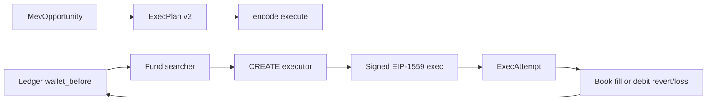

# Realistic virtual-wallet live execution

## Objective

Make `--exec revm|anvil` behave like a real MEV bot whose **only fiction is the wallet**: authenticated typed executor, real deploy/send/receipt, one searcher that survives blocks, and reverts/losses that cost gas. Detector math stays typed (no Lasagna raw-call executor).

### Acceptance (user scenario)

After this plan, a detected **Backrun** (also TwoHop/MultiHop) run with `--exec revm|anvil` must:

1. Build a Balancer flash-loan `ExecPlan` and send a real execute tx (CREATE-deployed executor, signed on Anvil / in-process on revm).
2. **Profitable on-chain** (`repay` ok + `net >= minProfit`) → tx succeeds; WETH profit unwraps to searcher; ledger books `wallet += net` where `net` is the searcher's **native balance delta** (already profit − gas).
3. **Unprofitable on-chain** (can't repay, or `net < minProfit`, or leg revert) → tx reverts like mainnet; ledger **debits gas only** (`revert_gas_wei`), no phantom fill.
4. Success with `net <= 0` (edge) → apply signed net as `exec_loss_wei`, skip as `NonPositiveNet`.

Requires: `--exec revm|anvil` (not `none`), Balancer vault + WETH configured, path V2/V3-family. Non-WETH borrow still executes on-chain (ERC20 → withdrawer) but the **native gas wallet will not credit ERC20 profit** — primary fidelity path is WETH/native backrun (matches current paper native ledger).

## Locked decisions (from source spec — keep)

- Executor ABI v2: operator-only `execute`, immutable `withdrawer` + `weth`, `minProfit` + `deadline`; typed legs only.
- Anvil: sign EIP-1559 locally + `eth_sendRawTransaction` (no impersonation).
- Delete testnet completely (`ExecMode::Testnet`, [`core/src/exec/testnet.rs`](core/src/exec/testnet.rs), `executor_address`).
- `operator == withdrawer == searcher` for this cut (profit unwrap lands in the gas wallet; dual-role split deferred).
- `min_profit = 1` borrow-token unit (on-chain floor matching ledger `net > 0`); deadline = chain `opp.timestamp + 12`, never wall clock.
- Deploy gas = setup overhead, **not** booked as a fill.

## Coverage vs source spec

Source: [`.qoder/specs/Realistic virtual-wallet \`live\` execution_ testnet removal + executor ABI v2.md`](.qoder/specs/Realistic%20virtual-wallet%20`live`%20execution_%20testnet%20removal%20+%20executor%20ABI%20v2.md).

**Fully covered (all 9 steps + verification intent):** ABI v2 contract + Forge tests, artifact regen, Rust plan/calldata/mod, revm CREATE + positioning, AnvilSender signed path, session wiring + cache, testnet deletion, ledger wallet/revert/loss + schema v13, docs/tests/verification, working-tree rebase note, risks.

**Previously compressed — now restored below (must not drop during implement):**
- Exact `receiveFlashLoan` userData decode `(Leg[], minProfit)`; keep `EthForwardFailed` if `sweepEth` reuses it; ctor rejects zero addresses.
- Named Forge tests: `test_only_operator`, `test_expired_reverts`, `test_min_profit_reverts`, `test_profit_goes_to_withdrawer` (withdrawer ≠ caller), `test_sweep_operator_only`; update fork test + `_plan`.
- Node regen one-liner recorded in docs; length assert `4 + 32 + 32*6 + 32 + 32*5`; rename `selector_matches_abi_v1` → v2.
- CREATE deploy gas 3M, gas price `basefee + 1 gwei`; `exec_plan_revm` nonce from `db.basic_ref(searcher)` for synthetic hash.
- Pending detection: `opp.mempool_only || detection_path == Pending`.
- Anvil send: `max_fee = eth_gasPrice * 2`, priority 1 gwei; absorb `testnet.rs` send before deleting it; remove free fns `impersonate_and_fund` / `deploy_executor` / `send_exec` / `send_tx` + impersonation test.
- `ExecContext` also deletes `executor` (not only testnet fields); cache insert rule: `tx_hash.is_some() || status || fail == ExecRevert`.
- live.rs checklist: drop `assert_testnet_chain`, `Testnet && key` bail, `ensure_exec_ready` Testnet arm; settings `exec_mode()` error text.
- `apply` / `apply_simulated` init new cost totals to 0; wallets recomputed from `starting_gas_wei` each pass (deterministic block-start fund).
- Verification items 4–8 from source in full (incl. `config` offline, anvil e2e + `report` reprint, remote-broadcast sanity).
- Risks/traps section kept verbatim in spirit (ABI+hex same change, reset-before-connect, deadline chain time, minProfit borrow-token units, `executor_address` config break).

**Explicitly NOT from source (our additions only):**
- `setup_gas_wei` observability (not booked into P&L).
- Extra loopback assert inside `AnvilSender::connect` (defense in depth; source relies on `AnvilNode::attach`).

**Do not touch:** `.cursor/plans/live_explorer_ops_guide_*.plan.md` (source: unrelated/untracked).

Out of scope (source + ours): operator rotation/pause, booking deploy gas, separate withdrawer EOA, Lasagna executor, config-driven `min_profit` (follow-up).

## Current fidelity gaps (what we fix)

- [`FlashArbExecutor.sol`](contracts/src/FlashArbExecutor.sol): ABI v1, no operator, plan-supplied `profitTo`/`weth`, no `minProfit`/`deadline`.
- [`revm_backend.rs`](core/src/exec/revm_backend.rs): injects `deployed.hex` at fixed [`EXECUTOR_ADDRESS`](core/src/exec/mod.rs); funds with `SEARCHER_FUND_WEI` and **resets nonce to 0**.
- [`anvil.rs`](core/src/exec/anvil.rs): `impersonate_and_fund`.
- [`ledger.rs` `apply_executed`](core/src/paper/ledger.rs): callback has no wallet; reverts/`net<=0` do **not** debit gas/loss.
- Schema head is v12 ([`migrate_v12_paper_exec`](core/src/explorer/store/schema.rs)); need v13 columns.

---

## Implementation order

### 1. Executor ABI v2 + Forge tests

Edit [`contracts/src/FlashArbExecutor.sol`](contracts/src/FlashArbExecutor.sol) to the source sketch (`ABI_VERSION=2`, immutables `operator`/`withdrawer`/`weth`, ctor all non-zero).

- `Plan`: drop `profitTo`/`weth`; add `minProfit`, `deadline`. Typed legs only.
- `execute` guard order: `NotOperator` → `Expired` → `Reentrant` → amount/vault/legs ≠ 0. Set `borrowBalanceBefore`, `activeVault`, `flashLoan`, then clear both.
- `receiveFlashLoan` decodes `(Leg[] legs, uint256 minProfit)`; repay first; `net = left > borrowBalanceBefore ? left - borrowBalanceBefore : 0`; `MinProfit`; if `net==0` return; else unwrap WETH when borrow==weth and send to `withdrawer`.
- `sweep` / `sweepEth` operator→withdrawer. Keep `EthForwardFailed` if `sweepEth` reuses it. No role mutation/pause.

[`contracts/test/FlashArbExecutor.t.sol`](contracts/test/FlashArbExecutor.t.sol): Vm shim `warp`/`prank`; selector/version → v2; add `test_only_operator`, `test_expired_reverts`, `test_min_profit_reverts`, `test_profit_goes_to_withdrawer` (withdrawer ≠ caller), `test_sweep_operator_only`; update fork test + `_plan`.

### 2. Artifacts regeneration (same change as contract)

- `"$HOME/.foundry/bin/forge" build` in `contracts/`.
- Copy `.bytecode.object` → `FlashArbExecutor.creation.hex`, `.deployedBytecode.object` → `deployed.hex` (strip `0x`, trailing newline) via the Node one-liner from the source (also recorded in docs).
- [`artifacts.rs`](core/src/exec/artifacts.rs): `ABI_VERSION = 2` + test; `append_address_args` (no alloy `sol-types`/`contract` features).
- Never inject `deployed.hex` (immutables zeroed) — deploy from creation + args only.

### 3. Rust plan + calldata v2

- [`plan.rs`](core/src/exec/plan.rs): drop `profit_to`/`weth`; add `min_profit: U256`, `deadline: u64`; `plan_from_opportunity(opp, pools, vault, provider, min_profit, deadline)`.
- Session values: `min_profit = U256::from(1)`, `deadline = opp.timestamp.saturating_add(12)` (chain time only).
- [`calldata.rs`](core/src/exec/calldata.rs): sig `execute((address,address,uint256,uint256,uint256,(address,address,address,uint8,uint24)[]))`; head 6 words, `legsOffset=192`; rename selector test → v2; length `4 + 32 + 32*6 + 32 + 32*5`.
- [`mod.rs`](core/src/exec/mod.rs): delete `EXECUTOR_ADDRESS` + `Testnet`; keep Anvil default key/address.

### 4. revm: real CREATE + positioning + wallet fund

- [`whatif.rs`](core/src/replay/whatif.rs): `WhatIfRun.created` from `Output::Create` (None on degraded); `execute_whatif` generic `DB: DatabaseRef + DatabaseCommit`.
- [`replayer.rs`](core/src/replay/replayer.rs): `tx_data_to_tx_env` EIP-1559 (`gas_price`/`gas_priority_fee` fallbacks); `build_next_block_env` (N+1, ts+12, basefee×1.125 saturating, same beneficiary/gas limit, spec blob fields).
- [`revm_backend.rs`](core/src/exec/revm_backend.rs):
  - `RevmBlock { state_block, exec_env, db, executor, nonce }`.
  - `open_revm_block(replayer, opp, searcher, withdrawer, weth, balance_wei)`: fund preserving nonce/code via `basic_ref`; CREATE with gas 3M, price `basefee+1 gwei`, bytecode+`[searcher,withdrawer,weth]`; assert `created == searcher.create(deploy_nonce)`.
  - Inclusion (`!pending`): `what_if_state(N)`, replay `txs[0..=tx_index]`, `exec_env=env(N)`.
  - Pending (`mempool_only || DetectionPath::Pending`): `what_if_state(N+1)`, `exec_env=next_block_env(N)`.
  - Log-only: pre-N, no replay, warn once.
  - `exec_plan_revm`: call `block.executor`, use `block.exec_env`, nonce from `db.basic_ref(searcher)` for synthetic hash; bump after commit.
  - Delete `inject_executor` / `SEARCHER_FUND_WEI`.

### 5. Anvil: `AnvilSender` (absorb signing from testnet, then delete testnet)

- Struct + methods per source: `connect` (eth_chainId + pending nonce + loopback assert), `fund` (`anvil_setBalance`), `deploy_executor`, `send_exec`.
- Send path from old `testnet.rs`: `TxEip1559`, `max_fee = eth_gasPrice * 2`, priority 1 gwei, `sign_hash_sync`, `encoded_2718`, `eth_sendRawTransaction`, nonce++ after send.
- Remove `impersonate_and_fund`, free `deploy_executor`/`send_exec`/`send_tx`, impersonation test; keep `rpc`/`reset_fork`/`wait_receipt`.
- `exec_key` else `ANVIL_DEFAULT_KEY`; sender = operator = withdrawer = searcher.

### 6. Session wiring

[`session.rs`](core/src/exec/session.rs):

- Keep `mode, chain_id, vault, weth, searcher, provider, fork_url, exec_key, anvil_bin, anvil, anvil_executor, anvil_block`; delete `testnet`, `testnet_executor`, `executor`; rename `submitted` → `cache`.
- Dispatch: `None` bails; `Revm`/`Anvil` only.
- `run_revm`: one `RevmBlock` per `(block_number, pending_kind)`; open with ledger `wallet_before` on that block’s first candidate.
- `run_anvil`: `reset_fork(N)` → `connect` (nonce after reset) → `fund(wallet_before)` → `deploy_executor([searcher,withdrawer,weth])` → `send_exec`; reuse deploy in-block via `anvil_executor`/`anvil_block`.
- Cache both backends: `submit_key(opp)`; `remember_attempt` when `tx_hash.is_some() || status || fail == ExecRevert`.
- Accumulate `setup_gas_wei` from deploy (observe only; not a fill).

### 7. Delete testnet surface

- Delete [`testnet.rs`](core/src/exec/testnet.rs), `mod testnet`, re-export.
- [`live.rs`](core/src/jobs/live.rs): drop `assert_testnet_chain` / `TestnetSender`; remove chain-id check, `Testnet && key.is_none()` bail, `ensure_exec_ready` Testnet arm; `--exec` error → `expected 'none', 'revm', or 'anvil'`.
- [`settings.rs`](core/src/config/settings.rs): remove `executor_address`; update `exec` docs + `exec_mode()` error (unknown TOML keys ignored).
- `mev-scout.example.toml`, [`cli/src/cli.rs`](cli/src/cli.rs) help, `README.md`.

### 8. Persistent virtual wallet + schema v13

[`ledger.rs`](core/src/paper/ledger.rs) `apply_executed`:

- Callback `FnMut(&MevOpportunity, u128 /* wallet_before */) -> ExecAttempt`; call `run(opp, wallet)`.
- Keep claimed-`gas_cost_wei` vs `wallet - reserve`; add early `wallet <= reserve_wei` → `InsufficientGas`.
- Revert / `status == false` with `gas_wei > 0`: debit gas, peak/drawdown, `revert_gas_wei`.
- Success `net <= 0`: `wallet.saturating_add_signed(net)`, `exec_loss_wei`, then `NonPositiveNet` skip.
- `apply_wallet_delta` helper; `apply` / `apply_simulated` init new totals to 0.
- Wallets recomputed from `starting_gas_wei` + booked deltas each pass → deterministic block-start fund.

[`types.rs`](core/src/paper/types.rs): `ExecAttempt::reverted(...)` for receipt timeouts (real revert receipts keep `ran(false,…)`); `LedgerResult`/`PaperSession` `revert_gas_wei`/`exec_loss_wei` (+ `setup_gas_wei`) with `#[serde(default)]`.

Schema/store: `migrate_v13_paper_exec_cost` ensure columns; DDL + insert/select/`row_to_session`. Live summary: `| revert gas X | loss Y | setup Z` when non-zero. Deploy gas documented as setup overhead, not booked.

### 9. Docs + tests + verification

Docs (additive on existing uncommitted edits): [`docs/CLI.md`](docs/CLI.md), [`docs/ARCHITECTURE.md`](docs/ARCHITECTURE.md), `README.md`, example toml, `artifacts.rs` module doc (incl. Node regen command, signed Anvil, roles/minProfit/deadline, new columns).

Rust tests: calldata v2 offsets/length/selector; artifacts `ABI_VERSION==2`; revm `CacheDB<EmptyDB>` CREATE+nonce; ledger wallet-param + revert debit + persistent wallet; anvil ctor args + signed send + non-operator (skip if no anvil/forge); session `submit_key`/`remember_attempt`; `cli/tests/cli_args.rs` help + `live --exec testnet` fails.

Verification gate:

1. `cargo fmt --all` then `cargo test --workspace`
2. `cd contracts && forge build && forge test`
3. Hex regen + `cargo test -p mev-scout-core exec::artifacts`
4. `cargo run -p mev-scout-cli -- config` still resolves
5. `live --exec testnet --blocks 1` fails; `live --help` has no testnet
6. `live --blocks 8 --sim state --exec revm` → header, exec ok/revert, recon, revert/loss only when real
7. `live --blocks 8 --exec anvil` → signed txs, wallet changes across blocks, `report` reprints session
8. `grep -rn "testnet|Testnet" core cli docs README.md` clean; no remote broadcast path

### Risks / traps (from source)

- ABI v2 + artifact hex must land together.
- `deployed.hex` immutables are zero — creation+args only.
- Anvil `reset` rewinds nonce → `connect` after `reset_fork`.
- Deadlines = chain timestamp, never wall clock.
- `minProfit` = borrow-token units.
- Removing `executor_address` is a config-surface break (unknown keys ignored).
- Deploy gas not booked (by design); `setup_gas_wei` is observe-only.
- Keep existing uncommitted docs edits; our doc edits are additive.
