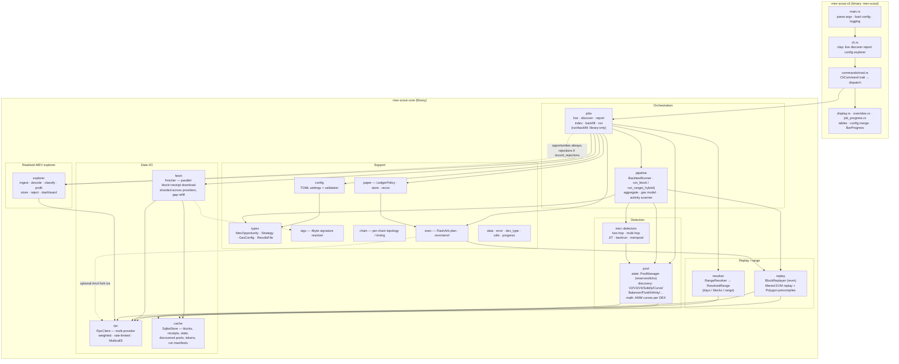
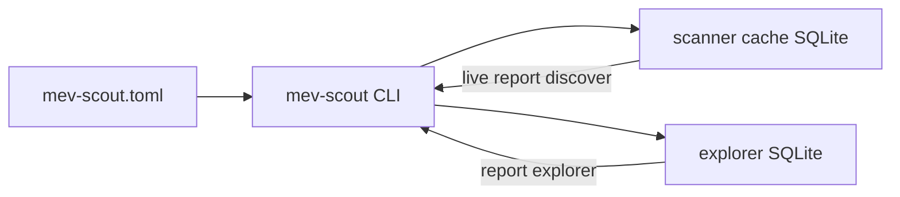

# mev-scout — Architecture

An MEV opportunity scanner & backtester for EVM chains (examples often Avalanche /
Polygon). Two crates: one engine library and one CLI host:

- **`core/`** — `mev-scout-core`: engine + stores + shared job orchestration.
- **`cli/`** — `mev-scout-cli`: thin binary (`mev-scout`) with 5 top-level
  subcommands (`live discover report config explorer`) plus the `explorer`
  nest. Parses args, loads config, presentation, dispatches to core.

Command reference, flags, and per-command flows: see [CLI.md](CLI.md).

---

## 1. Top-down module view

**Key relationships**

- The CLI is the only host: `CLI → core`. Shared long-running flows live in `core::jobs`.
  CLI hosts `live` / `discover` / `report` / `config` / `explorer`; `job_run`
  and `job_backfill` remain library-only.
- `pipeline` is the hub: `BacktestRunner` owns `BlockReplayer` + `PoolManager` and drives every detector per transaction.
- `cache` (SQLite) is the local-first backbone — `live` fetches blocks into it; the runner reads from it; pool discovery persists pools/tokens into it.
- `rpc` fronts the chain for everything: fetching, `eth_call` pool state, and replay's on-demand state misses (via `CachedRpcDb`).
- `explorer` answers "what was made" (realized MEV forensics) vs the detectors' "what could be made" — it ingests via RPC into its own SQLite store (`./cache/explorer-{chain}.sqlite`) so live index writes never contend with replay-path cache reads. Scanner `live` always persists detected opportunities there (via in-memory `ResultsFile` DTO); `record_rejections = true` also stores rejected candidates for miss attribution. The explorer dashboards open the store read-only (`ExplorerStore::open_read_only`).
- `exec` is opt-in from `live --exec revm|anvil`: builds Balancer flash-arb calldata (ABI v2) from `MevOpportunity`, deploys the executor from `creation.hex` + constructor args, runs it on revm / a local Anvil fork with signed EIP-1559 txs, and books P&L via `LedgerPolicy::apply_executed` (including revert-gas debit). Default remains paper/`--sim` only (no mainnet submit). Foundry sources live in `contracts/`; regenerate hex with:
  `node -e "const j=require('./contracts/out/FlashArbExecutor.sol/FlashArbExecutor.json'),f=require('fs');f.writeFileSync('core/src/exec/artifacts/FlashArbExecutor.creation.hex',j.bytecode.object.replace(/^0x/,'')+'\n');f.writeFileSync('core/src/exec/artifacts/FlashArbExecutor.deployed.hex',j.deployedBytecode.object.replace(/^0x/,'')+'\n')"`.
- **Atomic capital-free flow (Avalanche C-Chain, `chain_id=43114`)**: one EVM transaction performs Borrow → Callback → all swaps → Repay(capital + fee) → net-profit validation; any failure is a full `REVERT`. The flash loan is a **funding layer**, not an arbitrage family — it never adds a `MevKind`. Gas/priority fee remains payable in AVAX; C-Chain has **no PBS / BuilderTip**, so the auction bid is `priority_fee_wei` and `builder_bid` stays JSON `null` (an extension point only).
- **Layers vs families**: aggregator/router events (1inch, 0x, ParaSwap/Velora, Kyber, OpenOcean) are a **routing** layer decoded as `Amm::Aggregator` swap edges; they are not pool-discovery venues. V2-compatible forks on Avalanche (Pangolin V2, SushiSwap V2, Blackhole) share the V2 mechanics. GMX (two-transaction), Pendle PT/YT (yield/rate) and sAVAX rate arb are explicitly **out of core atomic arb** — retained only as forensic tags/evidence.
- **Funding cost is runtime state**: Balancer Vault fee, Aave premium, Uni V3 paid amount, LFJ in-kind fee and V2 flash-swap fee are read from live state (with contract defaults as fallback), never treated as an unconditional 0%. When the funding vault is also a route pool, a reentrancy risk flag is raised. DEX swap fees/slippage stay inside the simulated flow residual and must not be subtracted again from net profit.

---

## 2. Two SQLite stores

| Store | Typical path | Written by | Read by |
|---|---|---|---|
| Scanner cache | `./cache/{chain}-mev-scout.sqlite` (`Config::effective_db_path`) | `live` (incl. bootstrap token + pool seeding), `discover` | `live`, `discover`, `report` (manifests) |
| Explorer store | `./cache/explorer-{chain}.sqlite` (`Config::effective_explorer_db_path`) | `live` (opportunities; rejections when `record_rejections = true`; one `paper_sessions` ledger row per session), `explorer index` | `report`, `explorer` (dashboard: read-only) |

---

## 3. The engine core: how detection works

`BacktestRunner.run_block` (pipeline/runner.rs) is the heart of `run` and `live`:

1. **Load** block + txs from SQLite.
2. **Filter** — only txs whose `to` or log emitter matches a tracked pool/token are replayed through revm; all others are synthesized from cached receipts (the main performance optimization for large backtests).
3. **Detect (pre-apply)** on `S_{i-1}`: two-hop arb → multi-hop arb (negative-cycle search, hop cap ≤ 4) → JIT.
4. **Backrun pre-image** (`pre_detect`), then **apply** Swap/Sync/Mint/Burn/… via `PoolManager::update_from_logs`.
5. **Backrun post** (`post_detect` on `S_i`); mempool strategies only when `backtest.capture_pending` is set (default false) at range level in `run_range` / `run_range_hybrid`.
6. **Post-process** — backrun claims supersede the plain arb claim for the same key (`suppress_superseded_arbs`, so P&L is never double-counted), then dust filter (`min_profit_wei`), per-tx candidate cap, cross-block persistence scoring (decaying confidence, `PERSISTENCE_DECAY = 0.75`, grace 5 blocks), gas calibration from observed `gasUsed`.

The hybrid path (`run_range_hybrid`, used by `live`) picks `FullReplay` vs `LogOnly` per block based on `RpcClient::detect_state_horizon` (an on-chain archive-state probe, not a TOML key) — blocks deeper than available archive state skip EVM execution and lose only the EVM-context strategies.

## 4. Persistent artifacts

| Artifact | Produced by | Consumed by |
|---|---|---|
| Scanner cache `./cache/{chain}-mev-scout.sqlite` (blocks, receipts, state, discovered pools, tokens, run manifests) | `live` (incl. bootstrap), `discover` | `live`, `discover`, `report` (manifests) |
| Explorer store `./cache/explorer-{chain}.sqlite` — `opportunities` (+ optional `rejected_candidates`) | `live` (always opportunities; rejections when `record_rejections = true`) | `report` |
| Explorer store — `paper_sessions` / `paper_fills` (incl. optional `exec_*` / `sim_*` columns) | `live` (one session row written at session end; fills from assumed, state-sim, or executed net) | `report` (session P&L + `sim:` / `exec:` lines) |
| Checked-in FlashArb hex `core/src/exec/artifacts/FlashArbExecutor.{deployed,creation}.hex` | regenerate from `forge build` (`contracts/out/…`) | `core::exec::artifacts` (embedded at compile time) |
| Explorer store — forensic layer (blocks, txs, transfers, swaps, `mev_ops`, `tx_evidence`, sync_state, …) | `explorer index` | `explorer` CLI (HTML dashboard for the indexed range / all-time) |
| Static dashboard `results/explorer-<chain>-*.html` (gitignored) | `explorer` and `explorer index` (read-only; never migrates) | browser |
| Signature DB (4byte directory snapshot) | resolver only (`core::sigs::SignatureResolver`); `Fetcher::with_sig_resolver` exists but has **no callers** from jobs. Still **not wired** into `run`/`live` ingest | tx decoding (future) |

`ResultsFile` is an in-memory / presentation DTO (CLI tables) — not a durable on-disk JSON artifact. The V18 schema migration added the atomic-arb columns (`quote_expires_at`, `underlying_pools_hash`, `router_version`, `sim_block`, `basefee_wei`, `nonce`, `balance_wei`, `allowance_wei`, `risk_flags`, `optimal_amount`, `revert_gas_cost_wei`, `funding_source`, `net_profit_wei`, `priority_fee_wei`, `builder_bid`) to `opportunities`, `rejected_candidates`, `paper_sessions` and `paper_fills`; all are additive so pre-V18 rows deserialize unchanged. V19 adds the five WP6 backtest rates (`quote_drift_failure_rate`, `quote_expiry_failure_rate`, `same_block_competition_loss_rate`, `funding_fee_share_of_gas`, `revert_gas_share`) plus their raw counters to `paper_sessions` only.

The dashboard reads `paper_sessions` read-only and recomputes aggregate rates from the raw counters; a legacy file without V19 columns renders an empty metrics panel rather than failing the build.

---

## 5. Taxonomy axes and canonical identity

Tags are a persisted dashboard contract: **legacy string values are never renamed or deleted**. New attribution is added as namespaced tags over seven axes, and `types/tags.rs::TAG_AXIS_REGISTRY` / `axis_of_tag` are the single source of truth (unit-tested for uniqueness):

| Axis | Examples |
|---|---|
| `family` | `backrun` (an `ArbAtomic` + tag, not a new `MevKind`) |
| `mechanism` | `curve_imbalance`, `rate_provider_staleness`, `fot_arb`, `savax_rate_arb` |
| `venue` | `pharaoh_dlmm`, `lfj_v2`, `pangolin_v2`, `sushiv2` |
| `funding` | `flash_arb` (legacy alias) + `funding:balancer_v2_vault`, `funding:aave_v3`, `funding:univ3_flash`, `funding:lfj_lb_flash`, `funding:v2_flash_swap` |
| `execution` | `execution:single_tx` |
| `optimizer` | `optimizer:split_route` — an amount/route **optimization mode**, never a venue or a route-shape family |
| `routing` | `routing:paraswap_velora` — router provenance, not a pool |

The decoder (`explorer/decode/flash_loan.rs::flash_loan_funding_tag`) stamps the funding axis from the observed loan protocol; live detection stamps the same axis from `ArbTagPolicy.funding_source` (derived from `FlashLoanProvider::funding_source()`). The shared `types/tags.rs::canonical_funding_source` maps both config providers and decoded protocols (and the `funding:*` tag names used by older rows) to one value: `per-opportunity funding_source` and the realized `MevEvent.details.funding_source` therefore carry the same canonical string (`balancer_v2_vault`, `aave_v3`, …). The realized classifier writes it in `classify/arb.rs` from the decoded flash-loan log; `details.underlying_pools_hash` comes from the receipt's non-aggregator swap pools and `details.router_version` from the aggregator event topic (`decode/aggregator.rs::aggregator_router_version`).

Canonical IDs stay stable: `compute_canonical_id` (simulated) and `explorer_canonical_id` (realized) both append an optional, fixed-order suffix only when the extra provenance is present — `|h:<underlying_pools_hash>|r:<router_version>|f:<funding_source>`. The prefix is unchanged, so legacy IDs and stored rows keep their exact form. Two routers (or two underlying pool sets, or two funding paths) over the same endpoint pools therefore remain distinct rows. The retired legacy router event is still decoded for historical blocks under `LEGACY_ROUTER_SWAP_TOPIC`; live routing targets ParaSwap/Velora.

