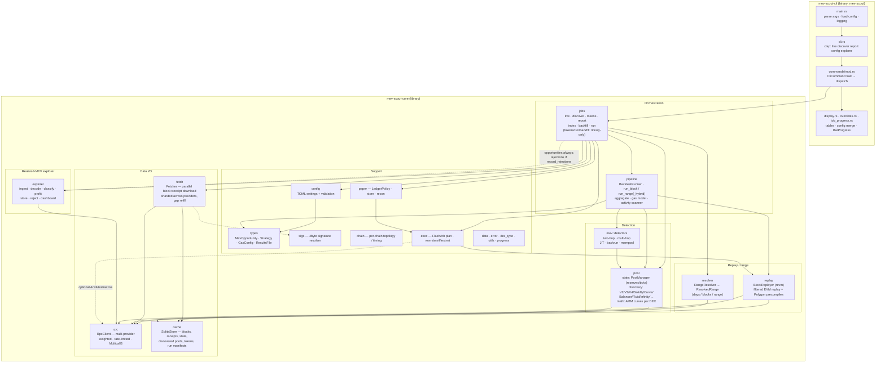
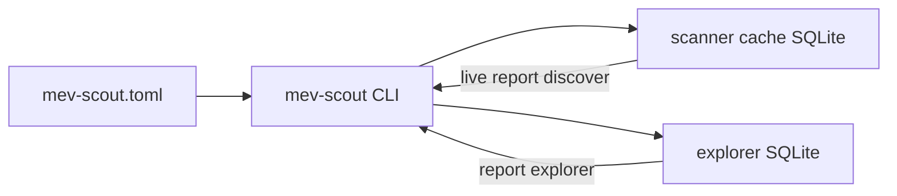

# mev-scout — Architecture

An MEV opportunity scanner & backtester for EVM chains (examples often Avalanche /
Polygon). Two crates: one engine library and one CLI host:

- **`core/`** — `mev-scout-core`: engine + stores + shared job orchestration.
- **`cli/`** — `mev-scout-cli`: thin binary (`mev-scout`) with 5 top-level
  subcommands (`live discover report config explorer`) plus the `explorer`
  nest. Parses args, loads config, presentation, dispatches to core.

Command reference, flags, and per-command flows: see [CLI.md](CLI.md).

---

## 1. Top-down module view

**Key relationships**

- The CLI is the only host: `CLI → core`. Shared long-running flows live in `core::jobs`.
  CLI hosts `live` / `discover` / `report` / `config` / `explorer`; `job_run`,
  `job_tokens`, and `job_backfill` remain library-only.
- `pipeline` is the hub: `BacktestRunner` owns `BlockReplayer` + `PoolManager` and drives every detector per transaction.
- `cache` (SQLite) is the local-first backbone — `live` fetches blocks into it; the runner reads from it; pool discovery persists pools/tokens into it.
- `rpc` fronts the chain for everything: fetching, `eth_call` pool state, and replay's on-demand state misses (via `CachedRpcDb`).
- `explorer` answers "what was made" (realized MEV forensics) vs the detectors' "what could be made" — it ingests via RPC into its own SQLite store (`./cache/explorer-{chain}.sqlite`) so live index writes never contend with replay-path cache reads. Scanner `live` always persists detected opportunities there (via in-memory `ResultsFile` DTO); `record_rejections = true` also stores rejected candidates for miss attribution. `explorer dashboard` opens the store read-only (`ExplorerStore::open_read_only`).
- `exec` is opt-in from `live --exec revm|anvil|testnet`: builds Balancer flash-arb calldata from `MevOpportunity`, runs it on revm / local Anvil fork / known testnets, and books P&L via `LedgerPolicy::apply_executed`. Default remains paper/`--sim` only (no mainnet submit). Foundry sources live in `contracts/`; runtime bytecode is the checked-in hex under `core/src/exec/artifacts/` (regenerate from `forge build`).

---

## 2. Two SQLite stores

| Store | Typical path | Written by | Read by |
|---|---|---|---|
| Scanner cache | `./cache/{chain}-mev-scout.sqlite` (`Config::effective_db_path`) | `live` (incl. bootstrap token + pool seeding), `discover` | `live`, `discover`, `report` (manifests) |
| Explorer store | `./cache/explorer-{chain}.sqlite` (`Config::effective_explorer_db_path`) | `live` (opportunities; rejections when `record_rejections = true`; one `paper_sessions` ledger row per session), `explorer index` | `report`, `explorer *` (dashboard: read-only) |

---

## 3. The engine core: how detection works

`BacktestRunner.run_block` (pipeline/runner.rs) is the heart of `run` and `live`:

1. **Load** block + txs from SQLite.
2. **Filter** — only txs whose `to` or log emitter matches a tracked pool/token are replayed through revm; all others are synthesized from cached receipts (the main performance optimization for large backtests).
3. **Detect (pre-apply)** on `S_{i-1}`: two-hop arb → multi-hop arb (negative-cycle search, hop cap ≤ 4) → JIT.
4. **Backrun pre-image** (`pre_detect`), then **apply** Swap/Sync/Mint/Burn/… via `PoolManager::update_from_logs`.
5. **Backrun post** (`post_detect` on `S_i`); mempool strategies only when `backtest.capture_pending` is set (default false) at range level in `run_range` / `run_range_hybrid`.
6. **Post-process** — backrun claims supersede the plain arb claim for the same key (`suppress_superseded_arbs`, so P&L is never double-counted), then dust filter (`min_profit_wei`), per-tx candidate cap, cross-block persistence scoring (decaying confidence, `PERSISTENCE_DECAY = 0.75`, grace 5 blocks), gas calibration from observed `gasUsed`.

The hybrid path (`run_range_hybrid`, used by `live`) picks `FullReplay` vs `LogOnly` per block based on `RpcClient::detect_state_horizon` (an on-chain archive-state probe, not a TOML key) — blocks deeper than available archive state skip EVM execution and lose only the EVM-context strategies.

## 4. Persistent artifacts

| Artifact | Produced by | Consumed by |
|---|---|---|
| Scanner cache `./cache/{chain}-mev-scout.sqlite` (blocks, receipts, state, discovered pools, tokens, run manifests) | `live` (incl. bootstrap), `discover` | `live`, `discover`, `report` (manifests) |
| Explorer store `./cache/explorer-{chain}.sqlite` — `opportunities` (+ optional `rejected_candidates`) | `live` (always opportunities; rejections when `record_rejections = true`) | `report` |
| Explorer store — `paper_sessions` / `paper_fills` (incl. optional `exec_*` / `sim_*` columns) | `live` (one session row written at session end; fills from assumed, state-sim, or executed net) | `report` (session P&L + `sim:` / `exec:` lines) |
| Checked-in FlashArb hex `core/src/exec/artifacts/FlashArbExecutor.{deployed,creation}.hex` | regenerate from `forge build` (`contracts/out/…`) | `core::exec::artifacts` (embedded at compile time) |
| Explorer store — forensic layer (blocks, txs, transfers, swaps, `mev_ops`, sync_state, …) | `explorer index` | `explorer` CLI (report + `explorer dashboard`) |
| Static dashboard `results/*.html` / `*.json` (gitignored) | `explorer dashboard` (read-only; never migrates) | browser / jq |
| Signature DB (4byte directory snapshot) | resolver only (`core::sigs::SignatureResolver`); `Fetcher::with_sig_resolver` exists but has **no callers** from jobs. Still **not wired** into `run`/`live` ingest | tx decoding (future) |

`ResultsFile` is an in-memory / presentation DTO (CLI tables) — not a durable on-disk JSON artifact.
