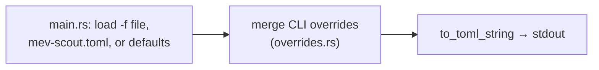
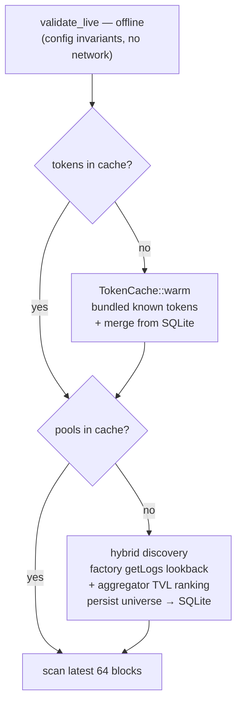
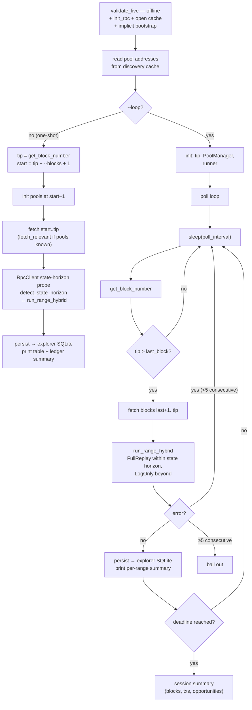
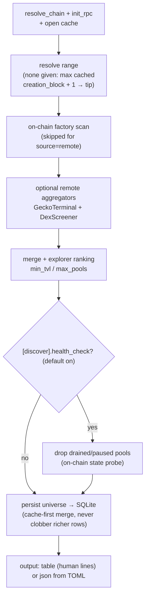
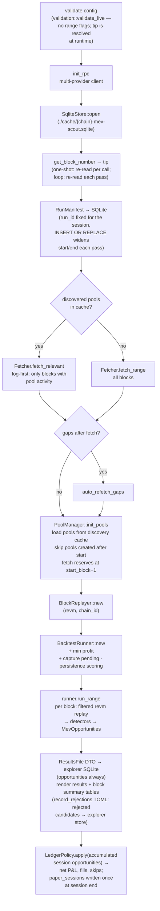
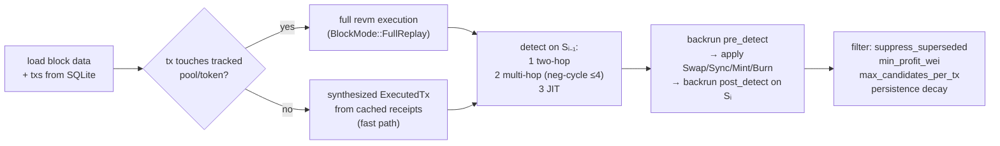
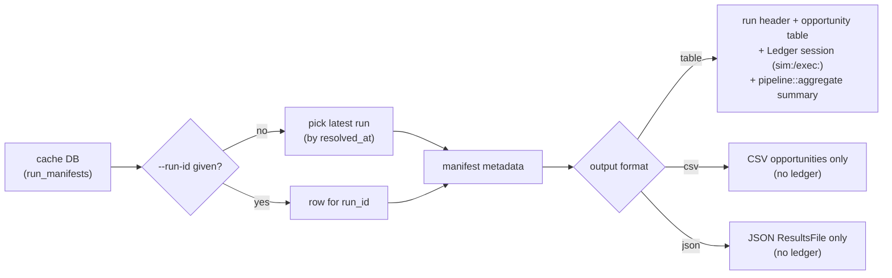
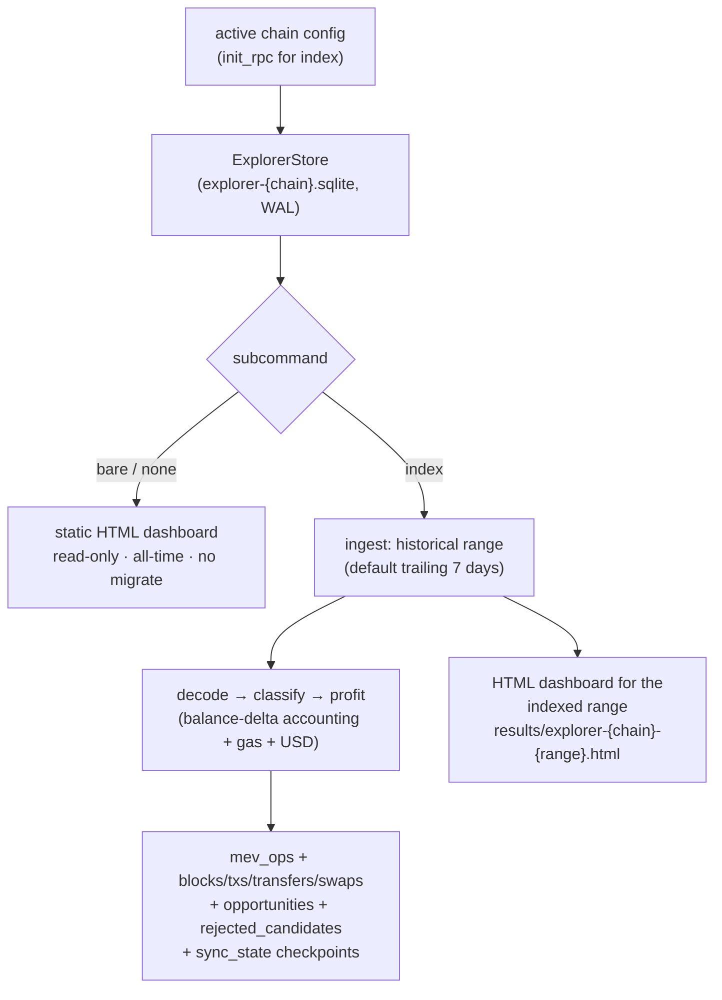
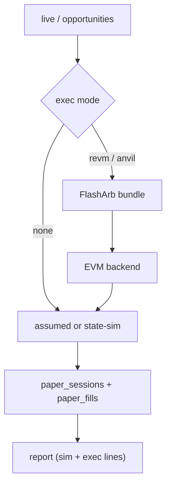

# mev-scout — CLI Command Guide

Command reference for the `mev-scout` binary (`cli/` crate): command map,
flags, config, and per-command flows. The module map, engine internals, and
persistent artifacts live in [ARCHITECTURE.md](ARCHITECTURE.md).

Invocation convention: the first example under each command uses
`cargo run -p mev-scout-cli -- --config mev-scout.toml …`. Later examples
shorten to `mev-scout` and assume the same config file and repo-root CWD.

---

## 1. CLI command map

| Command | Purpose | Chain access | Writes |
|---|---|---|---|
| *(no subcommand)* | Same as `live` — bootstrap if needed, scan the latest 64 blocks, exit | yes | SQLite cache, explorer SQLite |
| `live` | Detect at tip → opportunities + virtual P&L ledger | yes | SQLite cache, explorer SQLite |
| `discover` | Find pools (hybrid TVL ranking by default) | yes (RPC; aggregator HTTP unless `[discover].source = "onchain"`) | SQLite cache |
| `report` | Re-render a recorded run from SQLite | no | — |
| `config` | Print fully-resolved TOML | no | — |
| `explorer` | HTML dashboard of realized MEV: bare = all-time; `index` = backfill a range then emit its dashboard | bare: no; index: yes | Explorer SQLite (read-only for the dashboard); dashboard → `results/*.html` |

Product split: **`live`** = what *could* be made, plus the theoretical session
P&L of taking those detections with a virtual gas wallet (no competition);
**`explorer`** = what *was* made.

**Zero-config entrypoint.** The subcommand is optional: `mev-scout` with no
arguments behaves exactly like `mev-scout live`, and `live`'s window defaults to
the most recent 64 blocks, scanned once. On first run it seeds the token cache
from the bundled known-token list and runs hybrid pool discovery (on-chain
lookback + aggregator TVL ranking), so there is no setup command to remember.
Both steps are skipped once their caches are populated, and the config is
validated offline *before* any bootstrap RPC.

The `run`, `paper` and `tokens` commands were removed. `live` absorbed the first
two: it detects at chain tip and its paper ledger is always on. `tokens` became
the implicit bootstrap step. The range-scanning entry point (`run`) was dropped
from the CLI in favour of `live --blocks` for a bounded window; `report` prints a
run's ledger session alongside its results.

`explorer stats`, `explorer report`, `explorer backfill`, `explorer dashboard`,
and `explorer purge-retired` were removed — bare `explorer` renders the all-time
HTML dashboard, and `explorer index` is historical backfill (default trailing
7 days; tip-follow was removed) that always finishes with the dashboard for the
indexed range. Dashboard output is HTML-only; `--out` is the single file flag.

---

## 2. Shared concepts

### Globals

Every subcommand accepts:

```powershell
cargo run -p mev-scout-cli -- --config mev-scout.toml --verbose config
mev-scout --quiet live
mev-scout -f custom.toml config
```

| Flag | Effect |
|---|---|
| `-f` / `--config FILE` | Load this TOML (else `mev-scout.toml` if present, else defaults) |
| `-v` / `--verbose` | Debug-level tracing |
| `--quiet` | Set the log/tracing filter to `error` (suppresses log lines; program tables/summaries on stdout are unaffected) |

### Config (TOML, not clap flags)

Chain, RPC endpoints, strategies, gas model, and listing format live in the
TOML file. Clap does **not** expose `--chain`, `--rpc-urls`, or `--output`.

```powershell
copy mev-scout.example.toml mev-scout.toml
# edit chain = "avalanche"|"polygon", rpc_urls, output = "table"|"csv"|"json"
mev-scout config
```

Prefer `${ENV_VAR}` placeholders in RPC URLs; export keys in the same shell.
Unset placeholders stay literal and fail loudly at the provider. TOML `output`
is `table` | `csv` | `json`; **`report` honors all three**, while **`discover`
only special-cases `json`** (anything else prints human table lines — csv is
unimplemented there). Tuning knobs that used to be CLI flags live under
`record_rejections`, `[discover]`, `[live]`, and `[paper]` (see
`mev-scout.example.toml`). `batch_rpc` applies only to `job_run`; `live` leaves
batching off. `[backtest].strategies` is mostly inert for detector selection
today (detectors always run); an empty list still skips `init_pools` in `live`
and the list is recorded in run manifests.

### Block range

`discover` takes at most one of `--blocks`, `--block`, or
`--from-block`/`--to-block`. With no range it resumes from the newest cached
`creation_block` when the pool cache is populated, and otherwise scans the
chain's `pool_discovery_lookback_blocks` (1000) up to the tip.

```powershell
mev-scout discover
mev-scout discover --incremental
mev-scout discover --blocks 100
mev-scout discover --block 65000000
mev-scout discover --from-block 65000000 --to-block 65000100
```

Bare `explorer` renders the **all-time HTML dashboard** from the configured
explorer DB (read-only; never migrates). `explorer index` takes one trailing
`--window` (`Nh`/`Nd`/`Nw`, 365-day maximum, default `7d`) or exact
`--from-block`/`--to-block` bounds (mutually exclusive), and after a successful
backfill always emits the HTML dashboard for that range. The only output file
flag is `--out <PATH>`; without it the path is
`results/explorer-<chain>-<range>.html`. The DB accumulates rows across `index`
runs and `live`; dashboards for `index` cover the run's range.

`live --blocks N` (default 64) is the one-shot window, scanned as
`tip − N + 1 ..= tip`. It is not a discover-style range. `--loop` follows the
tip instead.

Two SQLite stores are written by these commands — see
[ARCHITECTURE.md §2](ARCHITECTURE.md#2-two-sqlite-stores) for paths and
writer/reader ownership.

---

## 3. Command reference (per command)

### 3.1 `config` — print resolved TOML

Prints the fully merged config (file + defaults) as TOML. Offline; no chain
access.

```powershell
cargo run -p mev-scout-cli -- --config mev-scout.toml config
mev-scout -f custom.toml config
mev-scout --verbose config
```

`--verbose` only raises log level; the TOML dump itself is unchanged.



### 3.2 `live` — the default command

The zero-config entrypoint. `mev-scout` with no subcommand is `mev-scout live`;
the run is bounded and exits, so it is safe to invoke from a script or a
scheduled job. Same engine as the removed range scanner, against chain tip.

For the end-to-end ops checklist, safety rails, and the dead-code/simplify
audit matrix, see [live_explorer_ops_checklist.md](live_explorer_ops_checklist.md).

```powershell
cargo run -p mev-scout-cli -- --config mev-scout.toml live
cargo run -p mev-scout-cli --                 # identical to the line above
mev-scout live --blocks 500                   # widen the one-shot window
mev-scout live --loop                         # keep following the chain
mev-scout live --loop --duration 1h
mev-scout live --loop --max-blocks 50
mev-scout live --initial-balance 1000000000000000000
mev-scout live --reserve 500000000000000000
mev-scout live --sim state                    # state-sim ledger (pool seeds)
mev-scout live --exec revm --blocks 32        # FlashArb on historical revm state
mev-scout live --exec anvil --blocks 8        # same path on a local Anvil fork
# poll_interval_ms → [live]; record_rejections → TOML
# starting wallet with no flag → [paper].starting_gas_wei
```

| Flag | Meaning |
|---|---|
| *(none)* | Scan the latest 64 blocks once, then exit |
| `--blocks <n>` | Width of the one-shot window (`tip − n + 1 ..= tip`); ignored with `--loop`; zero is rejected |
| `--loop` | Follow the tip, polling every `[live].poll_interval_ms` (2000) |
| `--duration` / `--max-blocks` | Stop conditions; **both require `--loop`** |
| `--initial-balance <wei>` | Virtual wallet seed; overrides `[paper].starting_gas_wei` |
| `--reserve <wei>` | Gas kept back from the wallet; overrides `[paper].reserve_wei` |
| `--sim <assumed\|state>` | Ledger fill mode; overrides `[paper].sim` (default `assumed`) |
| `--exec <none\|revm\|anvil>` | Virtual FlashArb backend; overrides `[paper].exec` (default `none`). Local only — never mainnet broadcast |

#### Implicit bootstrap

There is no setup command. Before the scan, `live` checks its own caches and
fills whatever is missing:



Order matches `cli/src/commands/live.rs` `bootstrap`: `bootstrap_tokens` then
`bootstrap_pools`. Pool bootstrap follows `[discover]` defaults
(`source = hybrid`, `min_tvl = 25000`); optional `[discover].lookback_days`
overrides the chain's `pool_discovery_lookback_blocks`. Override with
`[discover].source = "onchain"` for a pure factory scan with no aggregator
HTTP. Tokens still come from the bundled known-token list. Both steps log
what they did and are skipped on later runs. Bootstrap failures warn rather
than abort — the subsequent scan reports the real problem.

#### End-of-session report

When the session finishes (one-shot, or `--duration` / `--max-blocks` reached in
`--loop`), the ledger prints and persists:

```
  ledger: 3 fill(s), 0 skipped | net 6700000000000000000 wei ($2.8140)
  wallet: 100000000000000000000 ($42.0000) → 106700000000000000000 ($44.8140) | reserve 0 | max drawdown 0 wei
  funding: aave_v3 | fee 0 wei
  quotes: 0 expired / 1 drift | 0 risk-blocked (not in ledger)
  competition: est. 0 wei same-block bid premium
  metrics: drift 25.00% | expiry 0.00% | competition 0.00% | funding/gas 0.00% | revert/gas 0.00%
  by strategy (fills accepted):
    jit       1 fill   gas  0.800000  net      +4.200000 wei  $   1.7640
    arb       2 fills  gas  1.500000  net      +2.500000 wei  $   1.0500
```

- `wallet` is gas paid → gas plus realized net, so `ending − starting` is the
  session's profit.
- The `by strategy` rows come from `pipeline::aggregate_fills` on `PaperFill`s
  (`live.rs` `render_by_strategy`). Same aggregator *family* as table `report`'s
  `pipeline::aggregate` on opportunities, but **live fill rollup ≠ report
  opportunity rollup** — report does not reprint fill-by-strategy. Live rows are
  ordered by absolute net; their sum equals the headline `net`.
- Every accepted fill has `net > 0` by construction — `LedgerPolicy::apply`
  skips `net <= 0` as `NonPositiveNet`. The breakdown therefore only ever
  attributes profit; a gas-heavy candidate shows up under `skipped`, not as a
  losing row.
- USD columns appear only when a native price is already cached or can be
  resolved for display. Without one, amounts stay in wei.
- One `paper_sessions` row plus its `paper_fills` are written once at session
  end; `report` re-renders the same figures offline.

#### Session flow



### 3.3 `discover` — build the pool universe

Builds the pool set that detection reads from cache. Default source is
**`hybrid`**: on-chain factory events over the lookback window, merged with
GeckoTerminal/DexScreener, then ranked by TVL (`min_tvl` / `max_pools`) so the
list resembles a DEX explorer. Set `[discover].source = "onchain"` for a pure
factory scan with no aggregator HTTP.

```powershell
cargo run -p mev-scout-cli -- --config mev-scout.toml discover
mev-scout discover --blocks 2000
mev-scout discover --block 65000000
mev-scout discover --from-block 65000000 --to-block 65000100
mev-scout discover                          # incremental over a warm cache
# source / enrich / chunking / health check → [discover] in TOML
# machine-readable listing → output = "json" in TOML
```

| Flag / config | Concept |
|---|---|
| `[discover].source` | `hybrid` (default) \| `remote` \| `onchain` |
| `[discover].enrich` | Fill TVL on on-chain pools without adding remote-only rows |
| `--blocks` / `--block` / `--from-block`+`--to-block` | Lookback window, at most one form |
| `--incremental` | Resume from max cached `creation_block` |
| *(no range)* | Same as `--incremental` when the cache is populated, else `pool_discovery_lookback_blocks` → tip |
| `[discover].lookback_days` | Optional override of chain `pool_discovery_lookback_blocks` |
| `[discover].factory_batch_size` | Factory getLogs batch size override |
| `[discover].resolve_remote_metadata` | Resolve remote pool metadata (default `true`) |
| `[discover].min_tvl` | TVL floor for hybrid/remote ranking (default 25000) |
| `[discover].health_check` | Drop drained/paused pools (default on) |
| `[discover].max_pools` | Cap after TVL ranking (default 1000) |
| `output = "json"` | Machine-readable pool list (`table` = human lines; csv not implemented for discover) |
| `[discover].batch_size` / `rpc_concurrency` | getLogs chunk size and metadata concurrency |
| `[discover].solidly_fee_bps` | Fee override for Solidly-style pools |



### 3.4 Detection pipeline (shared by `live`)

The core engine. Everything is cached first, then replayed and detected.
Opportunities always land in the explorer store; set `record_rejections = true`
in TOML to also store rejected candidates for offline analysis. The paper
ledger is always on, so every session also reports virtual P&L.

The range-scanning entry point (`run`) was removed from the CLI; `live` drives
this engine at chain tip. `core::jobs::job_run` remains as a library function.



Inside `run_range` — per tx (`detect_tx` / log-only path):



Mempool / pending capture runs only when `backtest.capture_pending` is enabled
(default false) at range level.

### 3.5 `report` — re-render saved results

Offline. Reads run metadata from the cache DB (`run_manifests`) and
opportunities from the explorer DB. No chain access; no on-disk JSON result
files. Format follows TOML `output`.

```powershell
cargo run -p mev-scout-cli -- --config mev-scout.toml report
mev-scout report --run-id run_1717…
# set output = "csv" or "json" in mev-scout.toml for machine-readable forms
```

**One run per session, not per pass.** Before the `live`/`run` consolidation,
every `live --loop` pass wrote its own `run_id`, so `report` described a single
block-range scan. Now a whole `live` session — however many passes and blocks it
covers — is one run with one `run_id`: the manifest is `INSERT OR REPLACE`d to
widen `start_block`/`end_block` on each pass, and every pass's opportunities are
appended to the same run. `report` therefore always shows the whole session, and
its `Ledger session:` block is the session's cumulative P&L, not a single pass.

Runs written by the old per-pass scheme are still readable — they keep their own
`run_id`s and appear as separate entries.



### 3.6 `explorer` — realized-MEV forensics

Forensic reconstruction of MEV that was actually extracted on-chain — the
counterpart to the scanner's simulated opportunities. Pipeline: ingest → decode
→ classify → profit → store (`explorer-{chain}.sqlite`) → query surface below.
Runnable explorer steps and acceptance metrics live in
[live_explorer_ops_checklist.md](live_explorer_ops_checklist.md).
Scanner `run`/`live` persist opportunities into the same store; `record_rejections = true`
adds rejected candidates for offline analysis.



#### 3.6.1 Bare `explorer` — all-time HTML dashboard

Renders the forensic HTML dashboard covering **everything in the explorer DB**:
KPI totals, per-kind breakdown, daily trend, competitors
(bot = `COALESCE(contract, eoa)`), top searchers/pools, and per-op detail with
**Export tx JSON**. Read-only over the store (never migrates) — requires
history (seed it with `explorer index`). The DB path always comes from the
active chain config (`[explorer] db_path` or `./cache/explorer-<chain>.sqlite`).

```powershell
mev-scout explorer
mev-scout explorer --out results/avax-all.html
```

Without `--out`, the file is `results/explorer-<chain>-all.html`. The path is
printed and opened in the default browser (best-effort).

#### 3.6.2 `explorer index`

Index a historical block range into the explorer store (default: trailing
7 days), then emit the HTML dashboard for that range — idempotent and
gap-resumable via `blocks_classified`.
Use one `--window` (`Nh`/`Nd`/`Nw`, 365-day maximum) or an exact
`--from-block`/`--to-block` window (mutually exclusive). Tip-follow (`--loop`)
was removed; continuous detection stays on `live --loop`. `--window 24h`
covers the same span as `--window 1d`.

```powershell
mev-scout explorer index
mev-scout explorer index --window 6h
mev-scout explorer index --window 30d
mev-scout explorer index --from-block 65000000 --to-block 65001000
mev-scout explorer index --window 24h --out results/custom.html
# Re-run classifier/tag changes over already-indexed blocks:
mev-scout explorer index --from-block 65000000 --to-block 65001000 --reclassify
# Fill the scanner pool registry first (skim eligibility + venue tags):
mev-scout explorer index --window 24h --discover-pools
```

`--reclassify` deletes the range's derived facts (`mev_ops`, transfers,
swaps, txs, evidence, blocks, JIT journals) and re-indexes it; JIT open state
is replayed from the surviving journals. `--discover-pools` runs on-chain pool
discovery scoped to the same block range before indexing (active pools in the
range populate token pairs and venue tags; it does not scan the chain's full
lookback). Without a populated scanner cache the run prints
`WARNING: empty pool registry` because skim detection is disabled and venue
tags are missing.

Default output names: `results/explorer-<chain>-7d.html` (no range flag),
`results/explorer-<chain>-<window>.html`, or
`results/explorer-<chain>-blocks-<from>-<to>.html`.

Ingest tuning lives in TOML `[explorer]`: `confirmations` (plus classification
knobs).

#### 3.6.3 `explorer audit`

Opt-in audit of one transaction: dumps the stored ops + tx evidence and,
when a configured RPC serves it, a call trace. Tries
`debug_traceTransaction` (callTracer, with logs) first, then
`trace_transaction`; every attempt is recorded with the provider host
redacted so API keys never reach the output file. Public endpoints commonly
reject both methods, in which case the report still contains the stored
evidence and a hint to configure a trace-capable archive RPC.

```powershell
mev-scout explorer audit --tx 0x5e81…f212
mev-scout explorer audit --tx 0x5e81…f212 --out results/audit.json
```

Default output: `results/trace-<hash>.json`.

#### 3.6.4 Dashboard output

| Flag | Effect |
|---|---|
| `--out PATH` | Output HTML path; default `results/explorer-<chain>-<range>.html` |

The dashboard window follows the run: `index` uses the real timestamp span of
the indexed blocks `[from_block, to_block]` (falling back to all-time when no
block timestamps are recorded); bare `explorer` is all-time. Writing is atomic
(temp file + rename) and overwrites an existing file.

The artifact always covers the selected window. Artifact-size caps,
soft budget trimming, and gap sampling use fixed internal defaults
(`max_ops` 2000, `max_evidence` 500, `budget_mb` 8, `with_gaps` off) and are
not public flags.

Each operation detail includes **Export tx JSON**. The downloaded bundle
contains the full transaction fields/calldata, receipt metadata, raw event
logs, decoded token transfers, decoded swap events, the operation evidence,
the matching strategy rule (`classification_rule`), and a
`verification_context` block that states which context is missing.
`decision_inputs` repeats the exact transaction logs, transfers, swaps,
operation details/route, and related transaction IDs used by the classifier.
Related transaction IDs carry their full transaction bundles when persisted:
same-block causal backrun movers and cross-block JIT opening transactions.
Backrun exports also include `decision_inputs.causal_context`; JIT exports
include `decision_inputs.cross_block_context` with opening/closing transaction
bundles, the position lifetime, lifecycle timeline, and the in-range swaps that
validated the tick/bin range. For `utility/claim_and_sell`, `rule_evidence`
points at the zero-address mint transfer(s) and same-token sell swap(s) that
matched the classifier.
`internal_calls` / `internal_transactions` are present as explicit `null`
values with a `trace.status = "unavailable"` reason because the current ingest
path does not call a trace RPC; they are never presented as an empty call tree.
A future trace-aware collector can fill the same fields without changing the
export shape.

Artifact embeds coverage fractions next to every USD sum; `NULL` USD is `—`,
never zero. Schema capability banners appear when columns (e.g. `excluded_from_net`)
are missing on legacy files.

HTML notes (offline single-file):

- No global Strategy/Confidence/Pricing/Scope/Tags filter bar — panels always show
  full-window Rust aggregates (`kpi`, `series`, `strategy_series`, `scatter_points`, …).
- Additive `panels.op_index` is a compact interned full-window index used only for
  topbar search / ops list when `truncation.index_complete` is true. Fixed soft
  artifact-budget trim order: clear `evidence` → halve `events` (floor 50) → halve `scatter_points`
  (floor 200) → clear `op_index` (`index_emitted=0`, `index_complete=false`). A banner
  surfaces truncation; KPIs are never silently subset-filtered.
- Route evidence may include `amount_*_human` and `token_*_symbol` when the address is
  in `known_tokens.json` (names are optional / currently absent).

#### Classifier-change replay recipe (wipe + reindex)

Any change to `decode` / `classify` / P&L invalidates existing `mev_ops` rows for
the affected window, so before/after Phase numbers are only comparable after a
replay. `index` is replay-safe (INSERT OR REPLACE, idempotent), so the wipe is
required only for classifier *semantics* changes, not plain re-indexes.
Rewind the checkpoint and rewrite the historical window with a bounded
`explorer index`:

```bash
# 1) Wipe the affected window on the forensic DB (example: Polygon, from N).
#    Remove classified ops + classified-block markers and rewind the checkpoint.
sqlite3 cache/explorer-polygon.sqlite \
  "DELETE FROM mev_ops       WHERE block_number >= N;
   DELETE FROM blocks_classified WHERE block >= N;
   UPDATE sync_state SET indexed_to = N-1 WHERE chain_id = 137;"

# 2) Rewrite the window with --window or --from-block/--to-block.
mev-scout explorer index --window 24h
```

#### Phase-0 baseline recipe and ship gates

Historical-window recipe (e.g. Avalanche / Polygon): backfill a measurement
window, then inspect the emitted dashboard (`explorer index` writes
`results/explorer-<chain>-<window>.html` for that range):

```bash
mev-scout explorer index --window 24h
```

Record coverage notes on every phase merge (`cargo test` + clippy alone are not the
gate). Numbers are data-dependent — tests assert report *shape* only:

| Window | ops indexed | notes |
|---|---|---|
| *(pending — run recipe above with RPC)* | — | — |

Avalanche C-Chain factories in [`core/data/chains.toml`](../core/data/chains.toml)
now include LFJ V1 + Sushi + Pangolin V2, Curve Stableswap NG, Uni/Pharaoh/
Pangolin V3, LFJ LB + Pharaoh DLMM. Use public endpoints from
`mev-scout.example.toml` `[chains.avalanche]` (or a paid archive URL) and:

```bash
# config: chain = "avalanche"
mev-scout discover --blocks 2000
mev-scout explorer index --window 24h
```

Paste the dashboard KPIs into the notes above. Atomic arb is closed-cycle Exact
only (no mevlive parity catch-all).

Gates that depend on this table:
- **Phase 3 ship gate**: labeled golden set (Phase 0.5) must show acceptable
  backrun/frontrun precision. Synthetic CI set: `cargo test -p mev-scout-core golden`.
  Causal ops are tagged `tier=inferred` (logs-only) until REVM counterfactuals land.
  Chain-curated AVAX labels remain a follow-up once an RPC baseline window is available.

#### Known biases / methodology notes

- Logs-only backrun (a `backrun` tag on an `ArbAtomic`, not a separate kind) is
  **not** REVM `profit(B|before)` vs `profit(B|after)` — it is an inferred causal
  proxy with §23 evidence codes under `details.causal`.
- Contrast: the **scanner** now computes the tree's first `profit(B|before)` vs
  `profit(B|after)` differential — `BackrunDetector`'s net-flip rule (D3) over
  state `S_{i-1}` vs `S_i`. The realized explorer
  backrun annotation above stays logs-only; wiring the explorer to consume the
  scanner differential is a separate change.
- JIT covers Uni V3 Mint/Burn **and** LFJ/Pharaoh LB DepositedToBins/WithdrawnFromBins
  (bin range mapped into tick_lower/tick_upper; overlap = any same-pool swap).
- Avalanche liquidations: Aave V3 topic decode (pool in chains.toml); Aave V2
  LendingPool remapped via `aave_v2_pool` → `details.protocol = "aave_v2"`.
  Benqi qiTokens remapped via `liquidation_protocol_aliases` → `"benqi"`;
  seize amounts converted through shared `c_token_underlyings` +
  `exchangeRateStored`. BSC Venus uses the same alias + underlyings path.
  GMX V2 is deployed on Avalanche (docs.gmx.io: `LiquidationHandler`
  0x1eAa0E46a40CB7D6F656193d053493658548114e) — plan P3.7; GMX V1
  status on 43114 unverified (V1 keeper race is a gated §6.1 row).

| Bias | Status | Notes |
|---|---|---|
| Logs-only backrun tag | By design | Execution-price proxies ≠ REVM `profit(B\|before_A)` vs `profit(B\|after_A)`. `STATE_DELTA_MATCH` / `PROFIT_VERIFIED` are **not** REVM-verified. The arb's ledger residual keeps its own A19 confidence; causality stays `tier=inferred`. |
| Gas | Mitigated (Phase 2.1) | Prefer receipt `effectiveGasPrice`, then legacy `gasPrice`; only fall back to `base_fee + priority`. |
| Multi-token profit | Mitigated (Phase 2.3) | Persist sums USD across all positive residuals; `profit_token` remains display-primary. JIT fee-capture stays unit-reported (`profit_token=None`). |
| Hourly pricing / FOT | Partial | Hourly token prices at persist; FOT/rebase tokens flagged `usd_approximate` in details. Long-tail decimals via Multicall3; realized-rate fallback for unpriced residuals. |
| Uni V3 `Flash` | Deferred | Not netted as Aave-style flash loan (different callback repay semantics). |
| Sandwich contract mediation | Logs-only | `tx.to` on front/back tags `contract_mediated`; store-backed labeled-searcher registry not required. |
| JIT cross-block reorg | Known limitation | Exact-key + `>=` liquidity close; cannot restore a position whose Burn is unwound by a reorg. |

### 3.7 Ledger (was `paper`)

Session accounting over detected opportunities: a native gas wallet, greedy
per-block fill selection (pool-conflict aware). Live prints
`render_ledger_summary` / `render_by_strategy` (`ledger:`, `wallet:`,
`by strategy`, optional `caps:` / `blocks:`). Applied by `live` after every
pass and persisted once at session end. No mempool racing and **no mainnet
broadcast**.

WP6 adds a `metrics:` line and five additive `paper_sessions` columns. Rates
are stored as fractions (`0.12` = 12%) and rendered as percentages:

| Metric | Numerator / denominator |
|---|---|
| `quote_drift_failure_rate` | `quote_drift` gate rejects / all quote-gate candidates |
| `quote_expiry_failure_rate` | `quote_expired` gate rejects / all quote-gate candidates |
| `same_block_competition_loss_rate` | estimated PGA bid premium / accepted-fill gas |
| `funding_fee_share_of_gas` | already-netted flash-loan fee / accepted-fill gas |
| `revert_gas_share` | failed-attempt gas / (accepted-fill gas + failed-attempt gas) |

Raw counts and wei totals are stored with the rates so the dashboard can
recompute one aggregate across several sessions. The HTML health grid and CSV
`backtest_metrics` section show all five; the CSV keeps its nine-column header
by putting the rate in the `label` field. Competitive loss and funding fees are
informational only — neither is subtracted again from ledger P&L.

Fill modes (`--sim` / `[paper].sim`):

| Mode | Meaning |
|---|---|
| `assumed` (default) | Credit detector claim net after gas |
| `state` | Quote legs against seeded pool state (`apply_simulated`) |

Virtual execution (`--exec` / `[paper].exec`) — opt-in FlashArb path via
`contracts/FlashArbExecutor` ABI v2 (operator-only execute, immutable
withdrawer/weth, `minProfit` + `deadline`; Balancer flash → V2/V3 legs).
Default `none` leaves `--sim` alone:

| Mode | Backend |
|---|---|
| `none` | Paper / state-sim only |
| `revm` | Real CREATE deploy + in-process EVM on positioned historical state; ledger from executed net (revert gas debited) |
| `anvil` | Local Anvil mainnet-fork; signed EIP-1559 raw txs (`exec_key` or Anvil #0); wallet funded from ledger |

With `--exec` + `--sim state`, `live` also runs state-vs-exec recon
(`recon: state vs exec N pass / M fail / …`). JIT and non-V2/V3 paths skip
explicitly (`ExecStrategyUnsupported`). Session summary may show
`revert gas` / `loss` / `setup` (deploy overhead is observe-only).

The standalone `paper` command was removed — see §3.2 for the flags.

`[paper]` TOML: `starting_gas_wei`, `reserve_wei`, `max_fills_per_block`
(hard-capped at 32/block), `sim_max_candidates_per_block` (wired via
`LiveOpts` / `LedgerPolicy` / `with_sim_seeds`), `sim`, `exec`, `exec_key`
(also selects the Anvil signer), `anvil_bin`, `anvil_url`. Balance and reserve may be
overridden per session; `max_fills_per_block` and
`sim_max_candidates_per_block` are TOML-only. `paper_sessions` also stores
`revert_gas_wei`, `exec_loss_wei`, `setup_gas_wei`.

```powershell
mev-scout live --initial-balance 1000000000000000000
mev-scout live --reserve 500000000000000000
mev-scout live --sim state --exec revm --blocks 32
```


