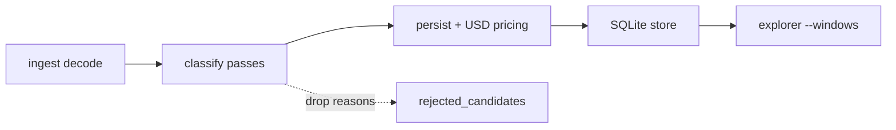

# Explorer improvements (phased)

**اهداف اول‌کلاس:** (1) دقت تشخیص kind/attribution، (2) دقت تخمین PnL (gross/net USD). هر فاز باید حداقل به یکی از این دو کمک کند؛ hygiene فقط وقتی ارزان و هم‌مسیر است.



---

## دقت تشخیص و PnL — اصول و کارهای مشخص

وضعیت فعلی که به دقت ضربه می‌زند:

| شکاف | اثر | پاسخ در پلن |
|------|-----|-------------|
| residual forwarded به third-party drop می‌شود | under-count ops و USD | Phase 1a |
| tip/builder ممکن است به‌جای profit شمرده شود (بعد از 1a) | over-count PnL | Phase 1a′ باریک |
| double-count JitArb / Frontrun vs Arb | inflate net | Phase 1c invariant |
| causal همیشه `Inferred` + threshold ثابت 0.5% | FP → noise در report | Phase 4 |
| `SUM(profit_usd)` مقدار `NULL` را 0 می‌گیرد؛ `usd_approximate` فقط در JSON | report خوش‌بینانه / بدون کیفیت | Phase 2c |
| liq cross-asset = `LIQ_BONUS_APPROX`؛ qi بدون rate = skip | قبلاً علامت‌گذاری شده | در report سطح کیفیت نمایش بده |
| tag بدون evidence (مثل savax بدون rate) | coverage دروغین، نه PnL مستقیم | Phase 2b |

**قواعد قفل‌شده برای PnL:**

- Gross = residual token(s) × قیمت؛ long-tail بدون قیمت → در aggregate اصلی **نیاید** (همان سیاست فعلی pricing docs)؛ report باید **تعداد/سهم unpriced** را جدا نشان دهد.
- Net = gross − gas_usd − flash_fee_usd؛ gas بدون native price → `NATIVE_UNPRICED` و net ناقص — در overview کیفیت بگو.
- فقط یک kind با P&L per `tx_index` (به‌جز Unknown tag-only).
- `Exact` vs `Inferred` در report قابل تفکیک؛ default overview می‌تواند هر دو را جمع کند ولی همیشه یک خط quality بدهد.

---

## Phase 1 — Attribution + hygiene (تشخیص + جلوگیری از inflate)

### 1a. Forwarded-profit heuristic

در [`core/src/explorer/classify/arb.rs`](core/src/explorer/classify/arb.rs) اگر candidate residual مثبت نداشته باشد → `continue` (تست scenario D در [`classify/mod.rs`](core/src/explorer/classify/mod.rs)).

**تصمیم:** چرخه closed + `flow_attributable`، ولی from/to net-zero:

1. آدرس‌هایی با residual مثبت روی `anchor`
2. دقیقاً یک recipient؛ نه در candidates؛ بدون مشارکت swap؛ تمام inboundهای anchor از `tx.from`/`tx.to`
3. → `searcher = recipient`، `confidence = Inferred`، tag `forwarded_profit`، `details.forwarded_from`

### 1a′. Tip sink باریک (از out-of-scope قبلی — **وارد پلن شد**)

بدون taxonomy کامل builder: بعد از پیدا کردن forwarded recipient، اگر آدرس در allowlist tip-sink زنجیره باشد (مثلاً `block.coinbase` وقتی از header در ingest در دسترس است، یا لیست کوتاه fee-recipientهای شناخته‌شده در config) → **emit نکن** / یا event با tag `builder_tip` و `profit_amount = None` تا PnL آلوده نشود.

**تصمیم:** prefer drop از P&L (no `mev_ops` row با USD)، نه شمارش به‌عنوان arb. Config اختیاری `tip_sink_addresses: []` + match روی `coinbase` از block header اگر ingest دارد.

### 1b. `DecodedTxFacts` به‌جای tuple ۱۵تایی

[`classify/mod.rs`](core/src/explorer/classify/mod.rs)، [`ingest.rs`](core/src/explorer/ingest.rs)، [`scenarios.rs`](core/src/explorer/scenarios.rs) — struct نام‌دار؛ بدون تغییر semantics.

### 1c. Kind precedence + invariant

`kind_precedence` یک منبع؛ تست: حداکثر یک event P&Lدار per `tx_index`.

---

## Phase 2 — Negative space + tag + گزارش `--windows`

### 2a. Classify drop reasons → `rejected_candidates`

گسترش [`RejectReason`](core/src/explorer/reject.rs): `OpenInventory`, `MixedFlowOwner`, `NetZeroSearcher`, `MaterialDeficit`, `UnresolvedCycle`, و در صورت 1a′: `BuilderTip`.

API:

```rust
pub struct ClassifyOutput {
    pub events: Vec<MevEvent>,
    pub rejects: Vec<RejectedCandidate>,
}
```

`strategy = "explorer_classify"`؛ یک flag مشترک با scanner `record_rejections`.

### 2b. سخت‌گیری `savax_rate_arb`

بدون `savax_exchange_rate_wad` → tag نزن. با rate → فقط divergence. `tag_modes` در details.

### 2c. گزارشات `--windows` ([`cli/src/commands/explorer/report.rs`](cli/src/commands/explorer/report.rs))

الان: coverage بلوکی، overview، by_kind، daily، competitors/senders/pools، top_ops؛ هشدار coverage &lt; 70%. SQL در [`store/query.rs`](core/src/explorer/store/query.rs) فقط `SUM(profit_usd)` / `SUM(net_profit_usd)`.

**تصمیم — افزودن quality slice به هر window (table + JSON):**

1. **Pricing coverage:** `%` ops با `profit_usd IS NOT NULL`؛ شمارش `usd_approximate` / reasons از `details_json` (حداقل `NATIVE_UNPRICED`, `MULTI_ASSET_PRICING`, `pricing_clamped`) اگر با SQL سبک یا یک pass روی top window قابل استخراج است — حداقل: `ops_priced` / `ops_unpriced` / `gross_usd_priced_only`.
2. **Confidence split:** یک ردیف یا زیرجدول `exact` vs `inferred` برای ops + net_usd (فیلتر SQL روی ستون `confidence`).
3. **Flag تمرکز:** اگر `highest_single_usd / net_usd > 0.4` در window → هشدار «one op dominates».
4. **CLI:** `--confidence exact|inferred|all` (default `all`) کنار `--kind` / `--windows` / `--top`.
5. **Rejects (اگر 2a روشن است):** یک خط اختیاری `classify_rejects` count by reason در همان window (از `rejected_candidates` با `strategy='explorer_classify'` و `block_number` در بازهٔ زمانی تقریبی یا join روی ts اگر موجود).

عمداً در این فاز نه: breakdown کامل per-tag در table اصلی (JSON می‌تواند `by_tag` سبک داشته باشد اگر ارزان است؛ وگرنه بعداً).

فایل‌های اصلی: `report.rs`, `store/query.rs`, شاید `ReportOverview` fields جدید.

---

## Phase 3 — Seed baselineهای pending

`frontrun` / `backrun` / `skim` → hunt → pin → `scenario_targets` + checklist. زنجیره اول ETH برای causal؛ AVAX برای skim اگر پیدا شد.

بدون شل کردن classifier اگر seed پیدا نشد.

---

## Phase 4 — Causal FP control (از out-of-scope قبلی — **وارد پلن شد**)

هدف: دقت تشخیص frontrun/backrun تا PnL report آلوده نشود.

**تصمیم (بدون REVM در مسیر live index):**

1. بعد از Phase 3 seeds، thresholdهای [`causal.rs`](core/src/explorer/classify/causal.rs) (`price_better_by(..., 0.5)`, `CAUSAL_WINDOW_TXS`) را روی corpus pinned بازبینی کن؛ مقادیر را به‌صورت ثابتِ مستند در کد نگه دار (نه magic بی‌توضیح).
2. اسکریپت/تست offline اختیاری: روی N op اینفر‌شده، `profit(B|after A)` با REVM فقط برای اندازه‌گیری FP rate — **نه** در `ingest` live. اگر REVM harness موجود نیست، فقط calibration از seeds + negative fixtures؛ REVM را به عنوان follow-up علامت بزن ولی در پلن بماند تا هدف دقت فراموش نشود.

---

## بازنگری «خارج از پلن» قبلی

| مورد | به اهداف دقت کمک می‌کند؟ | تصمیم جدید |
|------|-------------------------|------------|
| REVM causal / calibrate 0.5% | **بله** — FP مستقیم net را باد می‌کند | **وارد Phase 4** (calibrate اجباری؛ REVM offline ترجیحی) |
| Builder tip taxonomy کامل | **بله برای PnL** | **نسخه باریک در 1a′**؛ taxonomy کامل relay/builder هنوز خارج |
| `JIT_WINDOW_BLOCKS` time-based | کمی برای recall JIT روی L2 سریع | **خارج** — روی AVAX/Polygon پنجرهٔ ۱۰۰۰ بلوک کافی است مگر شواهد miss |
| `Box::leak` → `Arc` | خیر | **خارج** (hygiene خالص) |
| `candidate_unknown` sample rate | غیرمستقیم برای discovery، نه دقت فوری | **خارج** — بعد از quality report اگر gap بزرگ دیدیم |

---

## ترتیب اجرا و پذیرش

| فاز | Done when |
|-----|-----------|
| 1 | forwarded emit؛ tip-sink drop؛ `DecodedTxFacts`؛ invariant precedence |
| 2 | rejects persist؛ savax سخت؛ report هر window quality (priced/unpriced + exact/inferred) + `--confidence` |
| 3 | ≥1 seed واقعی frontrun یا backrun یا skim |
| 4 | thresholds causal مستند/کالیبره روی seeds؛ یادداشت FP (با یا بدون REVM sample) |

تست: `cargo test -p mev-scout-core explorer` (+ corpus؛ CLI args برای `--confidence` در `cli/tests` اگر لازم).
