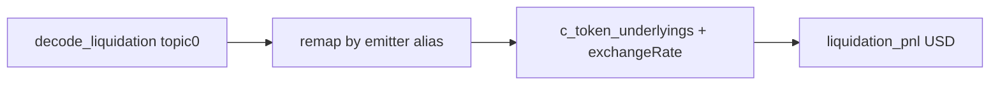

# Liquidation coverage (AVAX → Polygon → BSC)

Priority-weighted. No Maker/Liquity/Fluid. **Almost all value is config + thin ingest wiring.** Reuse [`remap_liquidation_protocol`](core/src/explorer/decode/liquidation.rs) + cToken conversion (today [`benqi_liq`](core/src/explorer/benqi_liq.rs)).

**Score target (priority-weighted ~40/35/25):** ~7 → ~8. AVAX 8.5→~9.0, Polygon 6.5→~7.5, BSC 5→~7 (Aave+Venus).

## Shared design (do before / with Phase 1)

### One map: `c_token_underlyings`
Benqi and Venus are the same Compound-V2 shape (`LiquidateBorrow`, `underlying()`, `exchangeRateStored`). **Merge now** — do not add a second `venus_v_underlyings` path.

- Config: prefer `[*.c_token_underlyings]`; keep serde `alias = "benqi_qi_underlyings"` so existing AVAX TOML migrates cleanly (or rename section in the same PR).
- Runtime: single `HashMap` on `IngestConfig`; one convert function with a protocol-neutral name (rename `convert_benqi_liquidation_events` / `QiRateCache` only as needed for clarity).
- Wiring/tests touched once.

### `aave_v2_pool` (first-class, Spark-style)
Add on [`ChainConfig`](core/src/config/defaults.rs); [`IngestConfig::from_chain`](core/src/explorer/ingest.rs) inserts `"aave_v2"` into `liquidation_protocol_aliases`. Pin **only with hunt evidence** except Avalanche (known live seed P0.1).

### Formal verification per phase
Each phase ships:
1. Corpus case(s) with `details.protocol` assert (+ USD non-null where underlyings apply)
2. Checklist row
3. Seed must not flag `TRANSFER_MISMATCH` (liquidator net inflow ≥ seize)

## Phase 1 — Avalanche

### 1a. Benqi underlyings → shared map
Nine qiTokens aliased as `benqi` but missing underlyings in [`chains.toml`](core/data/chains.toml): qiASD, qiEVC, isolated USDC/COQ/JOE/QI/AUSD/SolvBTC/NXPC.

**Work:** `eth_call underlying()` at tip → pin into `c_token_underlyings`.

**Ingest asserts ([`ingest.rs`](core/src/explorer/ingest.rs)):**
- Aliases already `len() == 22` (~1271) — **do not change**
- Underlyings `len() == 13` (~1279) → **`22`** only

Native-like / zero `underlying()`: omit row; USD stays null with reason (see negative tests).

### 1b. Aave V2 label
Pin Avalanche:
- `aave_v2_pool = "0x4F01AeD16D97E3aB5ab2B501154DC9bb0F1A5A2C"`

**Verify:** re-index `97782322`; corpus/assert `details.protocol == "aave_v2"` (flash already `aave_v2`). Extend checklist P0.1 note.

**Optional (not phase-critical):** while re-indexing, count `LiquidationCall` emitters outside `aave_v2` / `aave_v3` / `benqi`. If Silo/Euler volume appears → Phase 4 ticket only; do not pin defaults now.

## Phase 2 — Polygon

### 2a. Existing corpus first (before any hunt)
Already in [`explorer_corpus.rs`](core/tests/explorer_corpus.rs):
- `poly-liquidation-window` — ≥5 liq @ `94430973..=94431381`, searcher `0x7f1a…d990`
- `poly-liquidation-94431566` — 1 liq, same EOA (comment: priced $0 / count+searcher only)

If green and protocol correct, decode+classify on Polygon is **already proven**. Then:
- Add assert `details.protocol == "aave_v3"` (and USD non-null where prices exist; keep 94431566 flexible if historically $0)
- Checklist row `polygon.liquidation` pointing at these seeds
- **Fresh hunt only if** label wrong/missing or a new seed is required

### 2b. Aave V2 pin — evidence-gated
Candidate: `0x8dFf5E27EA6b7AC08EbFdf9eB090F32ee9a30fcf`.

In the same hunt window, **count** `LiquidationCall` on V2 vs V3. Pin `aave_v2_pool` **only if** V2 volume is non-zero. Same rule as Venus isolated: “include if unlabeled volume remains.”

No other Polygon fork aliases unless hunt shows material Compound-fork volume.

## Phase 3 — BSC (Aave first, then Venus)

Volume order: **Aave liquidation venue first**, Venus branding second.

### 3a. Aave V2 (highest Phase-3 ROI)
Aave liq amounts are already underlying — **no cToken conversion**; PnL via existing `liquidation_pnl`.

**Work:**
1. Hunt tip for `LiquidationCall` emitters; confirm which pool is live (BSC config today has `aave_v3_pool = 0x6807…` only — do **not** assume V2 address until hunt confirms).
2. Pin confirmed address as `aave_v2_pool` and/or ensure V3 pool label is correct for the emitter that actually fires.
3. First BSC liquidation corpus seed (today **zero** BSC liq seeds) with `protocol == "aave_v2"` or `"aave_v3"` as observed + USD when prices exist.
4. Checklist: `bsc.aave`.

### 3b. Venus
1. `getAllMarkets()` on Unitroller `0xfD36E2c2a6789Db23113685031d7F16329158384` → `[bsc.liquidation_protocol_aliases]` → `"venus"`.
2. Underlyings into **shared** `c_token_underlyings` (same convert path as Benqi).
3. Isolated pools via PoolRegistry `0x9F7b01…` only if core-only leaves unlabeled `LiquidateBorrow` volume.
4. Corpus: `protocol == "venus"` + USD non-null; checklist `bsc.venus`.

## Negative / edge tests (required)

| Case | Expect |
|------|--------|
| Alias present, underlying missing or `underlying()` zero | USD null + reason (`QI_EXCHANGE_RATE_MISSING` or successor); **never** wrong USD |
| Cross-market Benqi: debt ≠ collateral, both isolated | both sides converted |
| New seeds | no `TRANSFER_MISMATCH` (liquidator net ≥ seize) |

## Docs / checklist

| Row | When |
|-----|------|
| P0.1 note (AVAX V2 protocol) | Phase 1b |
| `polygon.liquidation` | Phase 2a |
| `bsc.aave` | Phase 3a |
| `bsc.venus` | Phase 3b |

Sync stale [`docs/CLI.md`](docs/CLI.md) if it still says Benqi stays `compound_v2`.

## Optional (chapter 10 — not phase-critical)

- `chainlink_feeds` for Polygon/BSC **after** first Aave seed, and only if interest/poke cases appear (P1.1 works with `ReserveDataUpdated` without feeds; feeds refine asset-level relevance).
- AVAX unlabeled-emitter count → Phase 4 if Silo/Euler volume (see 1b).

## Out of scope (unchanged)

- Maker Clip, Liquity, Fluid vaults, LLAMMA
- BuyCollateral verify (ETH-targeted)
- GMX ADL as `MevKind::Liquidation` (no LiquidationFact shape)
- Global rename of default decode label away from `aave_v3` (emitter-remap only)
