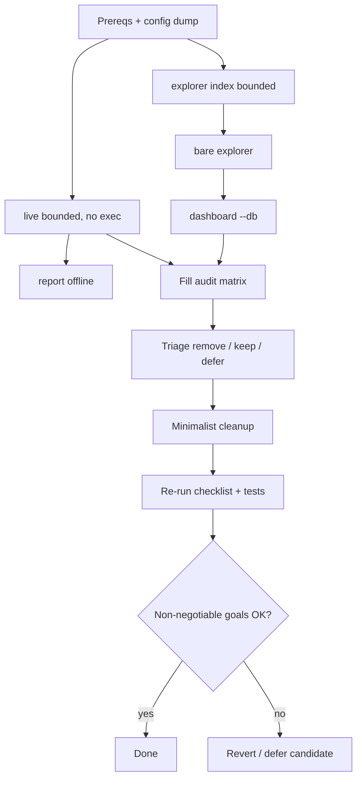

# Live + Explorer Ops Checklist and Minimalist Audit

Operational checklist for the `live` (paper ledger) and `explorer` (realized
MEV forensics) product surfaces, plus the evidence-gated process for removing
dead knobs and dead code. Code is the source of truth; this page is derived
from `cli/src/cli.rs`, `cli/src/commands/live.rs`,
`cli/src/commands/explorer*`, `core/src/jobs/{live,index,run,tokens}.rs`,
`core/src/config/{settings,validation}.rs`, and `mev-scout.example.toml`.

> **Phasing.** Section 0–6 are the Phase A deliverable (docs only). The audit
> matrix in §7 starts pre-seeded from a code read; Phase B removals are
> allowed **only** for rows whose observed evidence marks `safe = yes` and
> `goal impact = none`. If a removal breaks a non-negotiable goal or a test,
> revert or defer it.

---

## 0. Safety rails (read first)

- `--exec` accepts `none` (default), `revm`, or `anvil`. There is **no
  testnet mode** in the current binary (removed in commit `2624d2b`); do not
  reintroduce one without an explicit, separately reviewed opt-in.
- `--exec anvil` forks a local Anvil node at the current tip. It signs and
  sends locally; it never broadcasts to mainnet.
- `--exec revm` executes in-process against positioned historical state. No
  transaction leaves the process.
- Use scratch DBs for audits, or copy existing ones first:
  - scanner cache: `./cache/{chain}-mev-scout.sqlite`
  - explorer store: `./cache/explorer-{chain}.sqlite`
  - dashboard artifacts: `results/*` (gitignored)
- Do not point one `explorer.db_path` at multiple `[chains.*]` sections.
  `validate_explorer_db_isolation` rejects that at config load: explorer fact
  tables are not chain-keyed and would overwrite each other.
- The first `live` run may perform hybrid pool discovery (factory `eth_getLogs`
  + aggregator HTTP) when the pool cache is empty. To avoid extra network
  side effects use `[discover].source = "onchain"` or a pre-warmed cache.
- `--quiet` only lowers the tracing filter to `error`. Program output (tables,
  ledger lines, run ids) still prints to stdout.
- `report`, bare `explorer`, and `explorer dashboard --db` are offline. Only
  `live`, `discover`, and `explorer index` touch the chain.

---

## 1. Product split (one sentence each)

| Module | Question answered | Writes |
|---|---|---|
| `live` | What *could* have been captured, plus the virtual wallet ledger | scanner cache + explorer `opportunities` / `paper_*` |
| `explorer` | What was *actually* extracted | forensic tables (`mev_ops`, blocks/txs/transfers/swaps, rejects) |

Both share the SQLite artifact layout but not the writable paths (see §0).
Cross-import rules: `live` must not pull classify/dashboard code;
`explorer index` must not pull detectors or paper execution.

---

## 2. `live` — complete reference

### 2.1 Globals (all commands)

| Flag | Effect |
|---|---|
| `-f` / `--config FILE` | Load this TOML; otherwise `mev-scout.toml` if present, else defaults |
| `-v` / `--verbose` | Debug-level tracing |
| `--quiet` | Tracing filter `error`; stdout tables/ledger unaffected |

### 2.2 Flags (clap)

| Flag | Default | Notes |
|---|---|---|
| *(bare `mev-scout`)* | ≡ `live` with `LiveArgs::default()` | One-shot, 64-block window |
| `--blocks N` | `64` | One-shot window `tip − N + 1 ..= tip`; ignored with `--loop`; `N >= 1` |
| `--loop` | false | Follow the tip until Ctrl+C / stop condition |
| `--duration DUR` | none | **Requires `--loop`**; humantime (`90s`, `15m`, `1h 30m`) |
| `--max-blocks N` | none | **Requires `--loop`**; stops after N processed blocks |
| `--initial-balance WEI` | none → `[paper].starting_gas_wei` (`10e18`) | Exact wei, no price lookup |
| `--reserve WEI` | none → `[paper].reserve_wei` (`0`) | Must not exceed the starting wallet |
| `--sim assumed\|state` | none → `[paper].sim` (`assumed`) | Value validated in the job, not by clap |
| `--exec none\|revm\|anvil` | none → `[paper].exec` (`none`) | Value validated in the job; local only |

`--loop` and `--blocks` are not an error together; `--blocks` is simply
unused in loop mode. There is no CLI flag for `--chain`, `--rpc-*`, or
`--output`; those are TOML-only.

### 2.3 TOML that actually affects `live`

| Key / section | Effect on `live` |
|---|---|
| `chain` | Selects the `[chains.<name>]` section and DB filenames |
| `[chains.*]` addresses/factories/vaults | Pool init, exec context, router/factory decoding |
| `rpc_url`, `rpc_urls`, `rpc_rps`, `rps_limit`, `[chains.<name>.rpc]` | Provider construction and rate limits |
| `output.db_path` | Scanner cache path (`./cache/{chain}-mev-scout.sqlite` by default) |
| `gas_model`, `gas_limit`, `priority_fee_gwei`, `winning_bid_premium` | `GasConfig` for detection/cost estimates |
| `flash_loan_provider` | Fee bps for state-sim; exec provider selection |
| `strategies` | **Emptiness only** gates `init_pools`; membership does not gate detectors. Recorded in the manifest |
| `max_pairs_per_token`, `capture_pending`, `min_profit_wei`, `max_candidates_per_tx` | Passed into `BacktestRunner` |
| `record_rejections` | Persist rejected candidates to the explorer store |
| `[live].poll_interval_ms` | Loop sleep interval (default `2000`) |
| `[paper].*` | Wallet, reserve, fill cap, sim mode, seed budget, exec backend, signer, Anvil bin/url |
| `[discover].*` | Read **only when the pool cache is empty** (implicit bootstrap) |
| `explorer.db_path` | Explorer store used for persistence and the native-price cache |

### 2.4 TOML parsed but not read on the `live` path

These are candidates for §7, not necessarily dead everywhere:

| Key | Reality |
|---|---|
| `output.output` | Read by `report`, `discover`, bare `explorer`; `live` renders tables directly |
| `batch_rpc` | Read only by library `job_run`; `live` leaves batching off |
| `block_concurrency` | Read by explorer backfill and `job_run`; `live` uses provider-count parallelism |
| `rpc_batch_blocks` | Read by explorer ingest and `job_run`; `live` does not batch |
| `[explorer].confirmations`, `poll_interval_ms` | Explorer ingest only |
| `[explorer].causal_*`, `jit_*`, `interest_lookback_blocks`, `tip_sink_addresses` | Explorer ingest only |
| `[explorer].mev_tolerance_pct`, `mev_error_usd_tol` | Runtime validation + corpus tests only; no production reader |
| `[backtest].strategies` membership | Inert (see §2.3) |

### 2.5 Known dead-code probes (verify during evidence run)

- `LiveOpts.initial_balance_usd`, `LiveOpts.native_usd`,
  `LiveOpts.max_fills_per_block`, `LiveOpts.sim_max_candidates_per_block`:
  no clap flag; `cli/src/commands/live.rs` constructs them as `None`. They are
  library/test-only knobs today.
- `StdoutJsonProgress`: defined in `cli/src/job_progress.rs`, no constructor
  or dispatch path uses it.
- `Fetcher::with_sig_resolver` and `core::sigs`: no callers from jobs; the
  signature DB is not wired into ingest.
- `jobs::job_run`: library-only, used by core integration tests. `jobs::job_tokens`:
  no callers at all.
- `JobProgress::cancelled`: every binary sink returns `false`; `--loop` stops
  on duration/max-blocks or process kill, not via progress cancellation.
- Duplicate validation/parsing: `--duration`/`--max-blocks` are checked and
  parsed in `cli/src/commands/live.rs` and again in `core/src/jobs/live.rs`.

### 2.6 Runnable checklist (PowerShell, CWD = repo root)

```powershell
# 1) Prereq: config file. Skip if mev-scout.toml already exists.
copy mev-scout.example.toml mev-scout.toml

# 2) Offline config dump (no RPC).
cargo run -p mev-scout-cli -- -f mev-scout.toml config

# 3) Fail-fast checks (no successful RPC needed).
cargo run -p mev-scout-cli -- -f mev-scout.toml live --duration 15m        # must error: requires --loop
cargo run -p mev-scout-cli -- -f mev-scout.toml live --max-blocks 5        # must error: requires --loop
cargo run -p mev-scout-cli -- -f mev-scout.toml live --loop --duration notatime  # must error: invalid duration
cargo run -p mev-scout-cli -- -f mev-scout.toml live --exec testnet        # must error: invalid --exec

# 4) Minimal one-shot scan (writes cache + explorer DB).
cargo run -p mev-scout-cli -- -f mev-scout.toml --quiet live --blocks 8

# 5) Offline report for the same session.
cargo run -p mev-scout-cli -- -f mev-scout.toml report

# 6) Optional deeper paths (still no broadcast).
cargo run -p mev-scout-cli -- -f mev-scout.toml live --sim state --blocks 8
cargo run -p mev-scout-cli -- -f mev-scout.toml live --exec revm --blocks 8

# 7) Short loop smoke. Keep [live].poll_interval_ms small in the config.
cargo run -p mev-scout-cli -- -f mev-scout.toml live --loop --duration 30s
```

### 2.7 Acceptance metrics for `live`

- Exit code `0` for steps 4–7; explicit error text for step 3.
- `Run ID:` printed once per session; `ledger:` and `wallet:` lines printed.
- `paper_sessions` row count grows by exactly one per completed session.
- Scanner and explorer SQLite files grow; scanner rows land in `pools` /
  `tokens`, explorer rows in `opportunities` (and `paper_*`).
- No `eth_sendRawTransaction` in logs unless `--exec anvil` / `--exec revm`
  is selected; even then it is local.
- Loop-exit line `Paper session: <id>` is printed; `report` can re-render it.

---

## 3. `explorer` — complete reference

### 3.1 Subcommands

| Form | Writes | Chain access |
|---|---|---|
| `explorer` (bare) | — | none (pure SQL; config validation only) |
| `explorer index` | explorer DB | yes (historical fetch + classify) |
| `explorer index --loop` | explorer DB | yes (tip follow) |
| `explorer dashboard` | `results/*` | none with `--db`; optional live config otherwise |

Removed subcommands: `explorer stats`, `explorer report`, and
`explorer backfill`. Bare `explorer` is the revenue report; `index` without
`--loop` is the backfill.

### 3.2 Bare `explorer` flags (revenue report)

| Flag | Default | Notes |
|---|---|---|
| `--windows` | `1d,7d,30d` | Comma-separated `Nh` / `Nd` / `Nw` or `all`; deduplicated |
| `--kind` | none | Filter to one `MevKind` |
| `--top` | `10` | Leaderboards capped at 100 |
| `--confidence` | `all` | `exact` \| `inferred` \| `all` |

These flags belong to bare `explorer` only. Passing any of them together with
`index` or `dashboard` bails with an explicit error.

### 3.3 `explorer index` flags

| Flag | Default | Notes |
|---|---|---|
| `--loop` | false | Follow the confirmed tip; no historical catch-up |
| `--duration` | none | Requires `--loop`; humantime |
| `--days N` | `7` when no range flag | `1..=365`; trailing days to confirmed tip |
| `--from-block` | none | Requires `--to-block`; inclusive |
| `--to-block` | none | Requires `--from-block`; inclusive |

- `--loop` is incompatible with `--days` / `--from-block` / `--to-block`.
- Without `--loop` and without a range flag, the window is the trailing
  `DEFAULT_BACKFILL_DAYS = 7`.
- Without `--loop`, the job fetches with archive-capable providers and a
  confirmation lag (`[explorer].confirmations`, default 6).
- The resolved range must be non-empty and is sanity-capped at 100,000,000
  blocks.
- With `--loop`, indexing starts at `head − confirmations` and follows
  forward only; it does not backfill history.

### 3.4 `explorer dashboard` flags

| Flag | Default | Notes |
|---|---|---|
| `--db PATH` | none | Offline DB path; skips config/RPC |
| `--window` | `24h` | `all` \| `Nh` \| `Nd` \| `Nw` |
| `--out` | `results/dash.html` | Output path |
| `--format` | `html` | `html` \| `json` \| `csv` |
| `--max-ops` | `2000` | Embedded ops/events cap |
| `--evidence` | `500` | Evidence blobs for op drill-down |
| `--budget-mb` | `8` | Soft artifact budget; trims evidence first |
| `--with-gaps` | false | Sample unclassified gaps near tip |
| `--repeat` | none | Rewrite atomically every N (humantime) |

The dashboard opens the DB read-only and never migrates it.

### 3.5 `[explorer]` defaults and consumers

| Key | Default | Consumer |
|---|---|---|
| `db_path` | empty → `./cache/explorer-{chain}.sqlite` | all explorer commands; `live` persistence |
| `confirmations` | `6` | `index` (backfill and loop) |
| `poll_interval_ms` | `2000` | `index --loop` |
| `tip_sink_addresses` | empty | `index` / backfill |
| `causal_window_txs` | `8` | `index` / backfill |
| `causal_price_min_pct` | `0.5` | `index` / backfill |
| `jit_window_blocks` | `1000` | `index` / backfill |
| `interest_lookback_blocks` | `300` | `index` / backfill |
| `jit_pool_fee_bps` | `30` | `index` / backfill |
| `mev_tolerance_pct` | `20.0` | Validation + corpus tests; **no runtime reader** |
| `mev_error_usd_tol` | `0.50` | Validation + corpus tests; **no runtime reader** |

`index` copies these into `IngestConfig` before calling `run_range` /
`run_live`. Bare report and dashboard are SQL/read paths and do not consume
the classification knobs.

### 3.6 Runnable checklist (PowerShell, CWD = repo root)

```powershell
# 1) Bounded historical index (RPC + forensic writes). Pick a small window.
cargo run -p mev-scout-cli -- -f mev-scout.toml explorer index --days 1
#    or an exact window:
# cargo run -p mev-scout-cli -- -f mev-scout.toml explorer index --from-block <TIP-200> --to-block <TIP>

# 2) Offline revenue report.
cargo run -p mev-scout-cli -- -f mev-scout.toml explorer --windows 1d,7d --top 5

# 3) Offline dashboard from an explicit DB (no RPC, no migrate).
cargo run -p mev-scout-cli -- -f mev-scout.toml explorer dashboard `
  --db cache/explorer-avalanche.sqlite --format json --out results/dash.json

# 4) Short tip-follow loop.
cargo run -p mev-scout-cli -- -f mev-scout.toml explorer index --loop --duration 2m

# 5) Negative checks (must bail).
cargo run -p mev-scout-cli -- -f mev-scout.toml explorer index --loop --days 3
cargo run -p mev-scout-cli -- -f mev-scout.toml explorer index --duration 30s
cargo run -p mev-scout-cli -- -f mev-scout.toml explorer --windows 1d index
```

### 3.7 Acceptance metrics for `explorer`

- Exit code `0` for the positive steps; explicit error text for step 5.
- `mev_ops` and `blocks_classified` counts grow after `index`.
- Bare report renders one block per requested window with coverage and
  `(no data)` placeholders when empty.
- Dashboard `--db` succeeds with `mev-scout.toml` absent or unreachable;
  JSON/HTML is written under `results/`.
- `index --loop` logs the starting tip and stops at `--duration`; the
  checkpoint (`sync_state.indexed_to`) advances. Expect a possible overshoot
  of one in-flight batch (observed: `--duration 30s` finished a batch and
  exited after ~60s).
- Report flags on `index` / `dashboard` bail; `--days` + `--loop` bail.

SQL probes (use `sqlite3` from the repo root):

```powershell
sqlite3 cache/explorer-avalanche.sqlite ".tables"
sqlite3 cache/explorer-avalanche.sqlite "SELECT COUNT(*) FROM mev_ops;"
sqlite3 cache/explorer-avalanche.sqlite "SELECT COUNT(*) FROM blocks_classified;"
sqlite3 cache/explorer-avalanche.sqlite "SELECT COUNT(*) FROM opportunities;"
sqlite3 cache/explorer-avalanche.sqlite "SELECT COUNT(*) FROM paper_sessions;"
```

---

## 4. Evidence pack (input to Phase B)

Capture for every checklist step:

1. Command line, exit code, and the relevant stdout/stderr snippet.
2. SQLite counts before/after (`mev_ops`, `blocks_classified`, `opportunities`,
   `paper_sessions`, `paper_fills`).
3. Which TOML keys changed behavior: compare two `config` dumps, or grep the
   run's tracing log for the key's effect. Record keys that had none.
4. Which `core/src` / `cli/src` files were not reached: `--verbose` tracing,
   or call-site grep from the invoked command.
5. Any error that was environmental (RPC capability, rate limit) rather than a
   code path, so it is not mistaken for dead code.

Keep raw snippets in the PR description or a scratch note; do not commit DBs
or `results/*`.

---

## 5. Non-negotiable goals (Phase B acceptance gate)

If a simplification breaks any row below, revert or defer the candidate.

| Goal | Must remain |
|---|---|
| `live` product | One-shot + loop; paper wallet/ledger; persist to explorer DB; `--sim assumed\|state`; `--exec none\|revm\|anvil`; default `none`; no broadcast |
| `explorer` product | `index` (range/days + tip loop); bare report; read-only `dashboard` from `--db` |
| Isolation | Separate scanner vs explorer DB paths; `validate_explorer_db_isolation` stays |
| Safety | No unintended broadcast; `--exec anvil` only forks locally |
| Observability | Run ID / ledger lines; offline `report` after `live` |
| Config honesty | Every remaining `mev-scout.example.toml` key either affects a real path or is explicitly documented-as-future |
| Defaults | `blocks=64`, `poll=2000`, paper balances, explorer windows: unchanged unless fixing a bug |
| Tests | `cargo test` for touched packages stays green; a test may be updated only when its assertion targeted a removed dead path |

Out of scope for removal even if they look redundant: active detectors, paper
exec paths, classify/decode used by `index`, required schema migrations, and
clap guards (duration/range relationships).

---

## 6. Minimalist principles

1. **Evidence before removal.** No candidate is removed from intuition alone;
   fill the matrix from a real run.
2. **Dead knobs before architecture rewrites.** Config/CLI fields first, then
   dead helpers, then duplicate validate/parse paths.
3. **One source of truth.** If CLI and job both validate/parse duration, keep
   one.
4. **Library-only surface.** Wire it to the binary, mark it `pub(crate)` with a
   reason, or remove it. Do not leave an unreachable public command.
5. **Keep module isolation.** No new cross-imports between live detection and
   explorer classify/dashboard code.
6. **Defaults stay.** No behavior-change cleanup in this pass.
7. **Tests are a gate.** A failing test means `safe = no`, unless the test
   asserted a dead path.
8. **Small focused commits.** Dead config → dead CLI fields → dead progress
   types → dedup → docs sync. No big-bang rewrite.

---

## 7. Dead-code / simplify audit matrix (pre-seeded)

Columns: **Observed** = appearing in a real checklist run (not just code
read); **Optional path** = reachable only through a non-default flag; **Safe
to remove** = no non-negotiable goal and no live test depends on it; **Tests**
= which tests touch it; **Goal impact** = `none` or the goal it would break.

| # | Candidate | Evidence (code) | Observed in run | Optional path | Safe? | Tests | Goal impact | Decision |
|---|---|---|---|---|---|---|---|---|
| 1 | `gas.gas_limits` config | Parsed in `settings.rs`; no reader in `core/` or `cli/` | not in resolved dump; absent by default | no | yes | none found | none | **removed** |
| 2 | `[backtest].batch_rpc` | Read only by `job_run`; `live` never reads it | `live` unaffected | library `job_run` | no | core corpus via `job_run` | library API | keep |
| 3 | `LiveOpts.initial_balance_usd` | No clap; CLI sets `None` | CLI never sets it | library-only | no | `core/src/jobs/live.rs` unit tests | paper ledger flags | defer (library API) |
| 4 | `LiveOpts.native_usd` | No clap; CLI sets `None` | CLI never sets it | library-only | no | `core/src/jobs/live.rs` unit tests | ledger USD display | defer (library API) |
| 5 | `LiveOpts.max_fills_per_block` | No clap; CLI sets `None` | CLI never sets it | library-only | no | `core/src/jobs/live.rs` unit tests | paper fill cap | defer (library API) |
| 6 | `LiveOpts.sim_max_candidates_per_block` | No clap; CLI sets `None` | CLI never sets it | library-only | no | none found | state-sim seed budget | defer (library API) |
| 7 | `StdoutJsonProgress` | Defined; no constructor/dispatch | unused | none | yes (in-repo) | none found | none in-repo | keep (public embedding sink) |
| 8 | `Fetcher::with_sig_resolver` + `sigs` | No job caller; `ARCHITECTURE.md` documents "not wired" | unused | none | no | none found | future tx decoding | keep (documented future) |
| 9 | `jobs::job_run` | Library-only; core integration tests use it | not invoked by CLI | library-only | no | `core/tests/paper_corpus.rs`, `mev_corpus.rs` | library API | keep |
| 10 | `jobs::job_tokens` | No callers in binary or tests | never invoked | none | yes | none found | none | **removed** |
| 11 | `JobProgress::cancelled` always false | All binary sinks return false; `index --loop --duration` hung because `join!` waited on the poller | **hang reproduced** | no | no | none found | cancellation contract | **fixed** (`index.rs` poller exits on shared stop flag) |
| 12 | Duplicate duration/max-blocks validation | `cli/src/commands/live.rs` + `core/src/jobs/live.rs` | fail-fast messages observed before bootstrap | no | no (both are deliberate) | CLI tests | fail-fast safety | keep + document |
| 13 | `[backtest].strategies` membership inert | Only emptiness used; detectors unconditional | manifest recorded all four defaults | no | no | `core/tests/config.rs` | config honesty | keep + document emptiness-only |
| 14 | `[explorer].mev_tolerance_pct` / `mev_error_usd_tol` | Validation + corpus tests only | no effect on `live` | no | no | `core/tests/{mev,paper}_corpus.rs` | corpus gate | keep (documented corpus gate) |
| 15 | `[explorer]` classification knobs on `live` | Live never reads them | no effect on `live` | no | no (needed by `index`) | explorer tests | explorer product | keep |
| 16 | Live modules from `explorer index` | `job_index` imports ingest/store only | no detector/paper work in index | no | no (isolation) | — | isolation | keep |
| 17 | `output.output` on `live` | `live` renders tables directly | `live` ignored `output = "table"` (rendered tables by design) | no | no (report/discover need it) | `core/tests/config.rs` | report formats | keep |

A row was eligible for removal only when **Observed = exercised and
unaffected**, **Optional = no/library-only**, **Safe = yes**, and **Goal impact
= none**. Two rows qualified (`gas_limits`, `job_tokens`); both were removed.
Everything else is either a live library API, a documented future, or required
by another product surface.

### 7.1 Evidence log (2026-11-07, Avalanche)

Commands run from the repo root with `-f mev-scout.toml`:

| Step | Result |
|---|---|
| `config` | exit 0; 350-line resolved TOML (`avalanche`, `output = "table"`, `rps_limit = 5.0`) |
| `live --duration 15m` | exit 1: `--duration requires --loop` |
| `live --max-blocks 5` | exit 1: `--max-blocks requires --loop` |
| `live --loop --duration notatime` | exit 1: humantime parse error |
| `live --exec testnet` | exit 1: expected `none` / `revm` / `anvil` |
| `--quiet live --blocks 8` | exit 0 in 4m13s; `Run ID: live_1794066353`; blocks `99684956-99684963`; ledger 0 fills; wallet `10e18 → 10e18` |
| `report` | exit 0; re-rendered `live_1794066353` and `paper_live_1794066353` offline |
| `explorer index --from-block 99684950 --to-block 99684960` | exit 0; 11 blocks indexed, 0 ops in 12.8s |
| bare `explorer --windows 1d,7d --top 5` | exit 0; `11 blocks indexed, 0% coverage`; no RPC |
| `explorer dashboard --db … --format json` | exit 0; `schema=13 ops=0`; wrote `results/dash_evidence.json` |
| `explorer index --loop --days 3` | exit 1: cannot combine with `--loop` |
| `explorer index --duration 30s` | exit 1: requires `--loop` |
| `explorer --windows 1d index` | exit 1: report flags belong on bare `explorer` |
| `explorer index --from-block 100 --to-block 50` | exit 1: `--to-block < --from-block` |
| `live --loop --duration 30s` | exit 0; session summary printed; 0 blocks processed because setup consumed the 30s deadline |
| `explorer index --loop --duration 30s` | **hung past 30s** before the fix; poller never completed (`tokio::join!`). After the fix: exit 0, 32 blocks indexed, 4 ops total, ~60s (one in-flight batch overshoot) |

`sqlite3` is not installed on this host, so counts were taken from the
`report` / bare `explorer` counters instead of direct SQL. The explorer DB
contained 11 classified blocks and 0 `mev_ops` after the bounded index.

---

## 8. Phase B execution order (after the matrix is filled)

**Status (2026-11-07):** first pass executed. Removed `gas.gas_limits` and
`job_tokens` (rows 1 and 10) and fixed the `index --loop` termination bug
(row 11). The remaining candidates are deferred: they are live library APIs,
used by `job_run`/corpus tests, or explicitly documented as future work.

1. **Config surface** — remove/deprecate parsed-but-unused keys from
   `settings.rs` and `mev-scout.example.toml`; make `strategies` emptiness-only
   semantics explicit in docs/example, or wire membership.
2. **CLI / `LiveOpts` honesty** — remove or expose the no-clap fields; delete
   dead progress types.
3. **Dead library commands** — `job_run` / `job_tokens` / sigs: wire to the
   binary, keep with `pub(crate)` + reason, or remove.
4. **Dedup** — one validation and duration-parse path.
5. **Docs sync** — `docs/CLI.md`, this checklist, and `mev-scout.example.toml`
   must describe the same surface.

Acceptance after simplify:

- The §2.6 / §3.6 checklist still passes (`live --blocks 8`, `report`,
  bounded `explorer index`, bare report, `dashboard --db`).
- No non-negotiable goal (§5) is broken.
- `cargo test` for the touched packages is green.
- The diff is deletions/simplifications only; no new features in the same pass.


